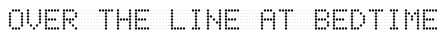

# Dot-matrix display

Use a dot-matrix display for text in CUI's 5×7 font. The gallery reports
whether the bedtime estimate is above or below the threshold. Available in **GUI**.



## Example

```pascal
unit Docs.Ui.Instruments.DotDisplay;

uses Fpas.Ui.Elements as E;
uses Fpas.Ui.Widgets.Display.DotDisplays as W;

// Displays the status at bedtime.
// ## Parameters
// - `AboveLimit`: Whether the estimate exceeds the threshold.
// ## Returns
// The display for the application view.
public function View(AboveLimit: bool): E.Element of string;
begin
  const Status: string := if AboveLimit then 'OVER' else 'UNDER' end if;
  return W.DotDisplay of string('bed-display', Status + ' THE LINE AT BEDTIME',
    new W.Options(Pitch := 3.0F, Accent := AboveLimit));
end function;

end unit;
```

## Options and defaults

| Option | Default or requirement |
| --- | --- |
| `Pitch / Color / Accent` | 0 / Automatic / false. Zero uses the native spacing. Accent selects the theme accent. |
| `Dim / Marquee` | true / false. Dim shows unlit dots. Marquee scrolls a line wider than the viewport. |
| `Align / Width` | Start / Content. Start and End follow the reading direction. Give a marquee a constrained width. |

## Interaction

The display is passive. Change the text in the view when the model changes.
CUI performs the marquee animation when enabled.

## See also

- [Widget API and types](../../../../src/Fpas.Ui/Widgets/Display/DotDisplays.fpas)
- [Gallery example](../../../../examples/ui/gui/gallery/Pages/Instruments/View.fpas)
- [Instruments](README.md)

## Source files

- `src/Fpas.Ui.Gui/Internal/Widgets/Display/`
  - [DotDisplay.fpas](../../../../src/Fpas.Ui.Gui/Internal/Widgets/Display/DotDisplay.fpas)
- `src/Fpas.Ui.Gui.Cui/Interop/Display/`
  - [NativeMethods.DotDisplay.cs](../../../../src/Fpas.Ui.Gui.Cui/Interop/Display/NativeMethods.DotDisplay.cs)
- `src/Fpas.Ui.Gui.Cui/Widgets/Display/`
  - [CuiWindow.DotDisplay.cs](../../../../src/Fpas.Ui.Gui.Cui/Widgets/Display/CuiWindow.DotDisplay.cs)
- `src/Fpas.Ui.Gui.Cui/native/widgets/display/`
  - [dot_display.c](../../../../src/Fpas.Ui.Gui.Cui/native/widgets/display/dot_display.c)
  - [dot_display.h](../../../../src/Fpas.Ui.Gui.Cui/native/widgets/display/dot_display.h)
