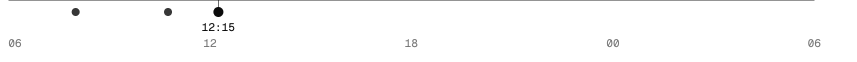

# Event track

Use an event track to edit discrete times on one axis. In the gallery each
marker is a cup of coffee. Moving a marker updates the chart and the readouts.
Available in **GUI**.



## Example

```pascal
unit Docs.Ui.Instruments.EventTrack;

uses Fpas.Ui.Elements as E;
uses Fpas.Ui.Widgets.Charts.DotCharts as D;
uses Fpas.Ui.Widgets.Charts.EventTracks as W;

// Builds the timeline for the cup editor.
// ## Parameters
// - `Cups`: Sorted times and selection from the model, such as `new W.Value([8.0, 10.75], 1)`.
// ## Returns
// The track with each proposed change as an application message.
public function View(Cups: W.Value): E.Element of W.Change;
begin
  return W.EventTrack of W.Change('cups', Cups, function(Change: W.Change): W.Change => Change,
    new W.Options(Capacity := 8, Minimum := 6.0, Maximum := 30.0, Step := 0.25,
      Units := D.AxisUnits.Hours, LabelStep := 6.0));
end function;

end unit;
```

## Options and defaults

| Field | Default or requirement |
| --- | --- |
| `Value.Times` | Supply sorted, finite times within the inclusive axis bounds. |
| `Value.Selected` | `-1` for no selection. Otherwise supply the zero-based index of a marker. |
| `Width` | `Fill`. Use the same width as the dot-matrix chart to align their time axes. |
| `Capacity` | `32`. The track can add markers up to this count. |
| `Minimum`, `Maximum` | `0`, `1`. Use the same bounds as the dot-matrix chart to share an axis. |
| `Step` | `0` for continuous pointer input. Positive steps snap additions and drags relative to `Minimum`. |
| `LabelStep` | `0` for automatic label spacing. |
| `Units` | `Number`. Use `Hours` for time-of-day labels. |
| `Format` | `null` for CUI's numeric format. Applies when `Units` is `Number` and `Label` is `null`. |
| `Label` | `null` for native labels. A callback formats axis and marker times and can capture application data. |
| `Add`, `Remove` | Both `true`. Set either flag to `false` to block the corresponding edit. |
| `Axis` | `true`. Set to `false` to hide the axis labels and shorten the track. |
| `Enabled` | `true`. Set to `false` to block input. |
| `NativeSelection` | `false`. Set to `true` to let CUI keep selection and ignore `Value.Selected`. |

With a custom `Label` callback, `Units` still controls automatic label spacing.
The time axis runs left to right in both interface directions.

## Interaction

Click empty space near the marker row to add a marker when `Add` is `true`
and capacity is available. Drag a marker to change its time. Selection
follows the marker when it passes another marker. Double-click a marker to
remove it when `Remove` is `true`.

With the track focused, use Up and Down to select a marker. Use Left or Right
to move it one step, or hold Shift to move ten steps. With `Step` at `0`, one
keyboard step spans one hundredth of the axis. Use Home and End to select the
first and last marker. Use Escape to clear selection.

If adding is available, Enter or Space adds a marker one step after the
selected time or at the midpoint if there is no selection. If `Remove` is
`true`, Delete or Backspace removes the selected marker.

## Change message

While enabled, the track sends `Change` when an event moves, appears, or is
removed. It also sends `Change` when selection changes or a drag starts or ends.

| Field | Result |
| --- | --- |
| `Current` | Proposed sorted times and the selected index. Store `Current` to accept the proposal in the model. |
| `Changed` | `true` if CUI moved, added, or removed a marker in this frame. |
| `Added` | Index of the new marker, or `-1` if the frame added no marker. |
| `Removed` | Former index of the removed marker, or `-1` if the frame removed no marker. |
| `Dragging` | `true` while a drag is in progress. |

## See also

- [CUI widget inventory](../../../cui-widget-inventory.md#cui_event_track)
- [Gallery update function](../../../../examples/ui/gui/gallery/Pages/Instruments/Update.fpas)
- [Dot-matrix chart](dot-chart.md)
- [Instruments](README.md)

## Source files

- `src/Fpas.Ui/Widgets/Charts/`
  - [EventTracks.fpas](../../../../src/Fpas.Ui/Widgets/Charts/EventTracks.fpas)
- `src/Fpas.Ui.Gui/Internal/Widgets/Charts/`
  - [EventTrack.fpas](../../../../src/Fpas.Ui.Gui/Internal/Widgets/Charts/EventTrack.fpas)
- `src/Fpas.Ui.Gui.Cui/Interop/Charts/`
  - [NativeMethods.EventTrack.Types.cs](../../../../src/Fpas.Ui.Gui.Cui/Interop/Charts/NativeMethods.EventTrack.Types.cs)
  - [NativeMethods.EventTrack.cs](../../../../src/Fpas.Ui.Gui.Cui/Interop/Charts/NativeMethods.EventTrack.cs)
- `src/Fpas.Ui.Gui.Cui/Widgets/Charts/`
  - [CuiWindow.EventTrack.Types.cs](../../../../src/Fpas.Ui.Gui.Cui/Widgets/Charts/CuiWindow.EventTrack.Types.cs)
  - [CuiWindow.EventTrack.cs](../../../../src/Fpas.Ui.Gui.Cui/Widgets/Charts/CuiWindow.EventTrack.cs)
- `src/Fpas.Ui.Gui.Cui/native/widgets/charts/`
  - [event_track.c](../../../../src/Fpas.Ui.Gui.Cui/native/widgets/charts/event_track.c)
  - [event_track.h](../../../../src/Fpas.Ui.Gui.Cui/native/widgets/charts/event_track.h)
