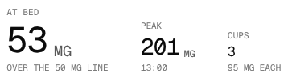

# Readout

Use a readout for a value with a label, optional unit and a line of context.
The gallery shows the estimated caffeine at bedtime, the daily peak and the cup count.
Available in **GUI**.



## Example

```pascal
unit Docs.Ui.Instruments.Readout;

uses Fpas.Ui.Elements as E;
uses Fpas.Ui.Widgets.Display.Readouts as W;

// Displays the caffeine estimate for bedtime.
// ## Parameters
// - `Milligrams`: Value already formatted for display.
// - `AboveLimit`: Whether the estimate exceeds the threshold.
// ## Returns
// The readout for the application view.
public function View(Milligrams: string; AboveLimit: bool): E.Element of string;
begin
  const Detail: string := if AboveLimit then 'OVER THE 50 MG LINE' else 'UNDER THE 50 MG LINE' end if;
  return W.Readout of string('at-bed', 'AT BED', Milligrams,
    new W.Options(Unit := 'MG', Detail := Detail, Size := W.Size.Large, Accent := AboveLimit));
end function;

end unit;
```

## Options and defaults

| Option | Default or requirement |
| --- | --- |
| `Label` | Text above the value. Pass an empty string to omit the label. |
| `Value` | Literal text in a monospaced font with tabular digits. Format the value in your view. |
| `Unit` | Empty. The unit follows the value in the reading direction and uses the same baseline. |
| `Detail` | Empty. The detail wraps below the value. |
| `Size` | `Medium`. `Small`, `Medium` and `Large` use 17, 28 and 44 logical points for the value. |
| `Tone` | `Neutral`. The neutral tone uses the theme foreground for the value. |
| `Accent` | `false`. If enabled, the theme accent takes precedence over `Tone`. |
| `Align` | `Start`. `Start` and `End` follow the reading direction. `Left` and `Right` use physical edges. `Center` centers each line. |
| `Width` | `Content`. Use `Fill`, `Fixed` or `Percent` to control the space for alignment. |

## Interaction

The readout is passive. Pass updated text when the underlying value changes.

## See also

- [CUI widget inventory](../../../cui-widget-inventory.md#cui_readout)
- [Widget API and types](../../../../src/Fpas.Ui/Widgets/Display/Readouts.fpas)
- [Gallery example](../../../../examples/ui/gui/gallery/Pages/Instruments/View.fpas)
- [Instruments](README.md)

## Source files

- `src/Fpas.Ui.Gui/Internal/Widgets/Display/`
  - [Readout.fpas](../../../../src/Fpas.Ui.Gui/Internal/Widgets/Display/Readout.fpas)
- `src/Fpas.Ui.Gui.Cui/Interop/Display/`
  - [NativeMethods.Readout.cs](../../../../src/Fpas.Ui.Gui.Cui/Interop/Display/NativeMethods.Readout.cs)
- `src/Fpas.Ui.Gui.Cui/Widgets/Display/`
  - [CuiWindow.Readout.cs](../../../../src/Fpas.Ui.Gui.Cui/Widgets/Display/CuiWindow.Readout.cs)
- `src/Fpas.Ui.Gui.Cui/native/widgets/display/`
  - [readout.c](../../../../src/Fpas.Ui.Gui.Cui/native/widgets/display/readout.c)
  - [readout.h](../../../../src/Fpas.Ui.Gui.Cui/native/widgets/display/readout.h)
