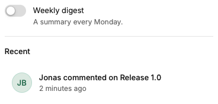

# Divider

The Notifications sheet separates preference switches from recent activity
with a divider. Available in **GUI**.



## Example

```pascal
unit Docs.Ui.Layout.Divider;

uses Fpas.Ui.Elements as E;

// Separates notification preferences from recent activity.
// ## Parameters
// - `Preferences`: The controls above the divider.
// - `Recent`: The view below the divider.
// ## Returns
// The two sections with a divider between them.
public function View(Preferences: E.Element of string; Recent: E.Element of string): E.Element of string;
begin
  return E.Column of string(Preferences, E.Divider of string(), Recent);
end function;

end unit;
```

## Options and defaults

| Option | Default or requirement |
| --- | --- |
| `Title` | Empty. Pass a string to add a caption. |

## Usage

Place the divider between adjacent groups. The separator is passive.
The gallery adds its Recent heading as a separate label beneath the line.

## See also

- [Widget API and types](../../../../src/Fpas.Ui/Elements.fpas)
- [Gallery example](../../../../examples/ui/gui/gallery/Pages/Overlays/Widgets/Notifications.fpas)
- [Sheet and drawer](../overlays/sheet.md)
- [Layout](README.md)
