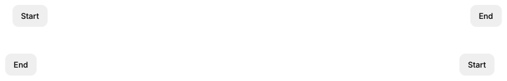

# Reading direction and spacing

Layout shows the same Start and End controls in left-to-right and
right-to-left rows.
Available in **GUI**.



## Example

```pascal
unit Docs.Ui.Layout.ReadingDirection;

uses Fpas.Ui.Elements as E;
uses Fpas.Ui.Layout as L;

// Places the two labels on opposite sides of a mirrored row.
// ## Returns
// A row with explicit leading inset, gap and spacer.
public function View(): E.Element of string;
begin
  return E.Row of string(
    new L.Flow(
      ReadingDirection := L.Direction.RightToLeft,
      Padding := L.Spacing.Fixed(L.Measure.Logical(12)),
      PaddingStart := L.Spacing.Fixed(L.Measure.Logical(24))
    ),
    E.Text of string('Start'),
    E.Gap of string(L.Measure.Logical(12)),
    E.Spacer of string(),
    E.Text of string('End')
  );
end function;

end unit;
```

## Options and defaults

| Option | Default or requirement |
| --- | --- |
| `ReadingDirection` | Inherit. `LeftToRight`, `RightToLeft` and `Auto` require the GUI host. |
| `PaddingStart / PaddingEnd` | null / null. A value overrides the base padding for that logical edge. |
| `Gap / Spacer` | Gap is a fixed child on the main axis. A spacer grows horizontally in a row or vertically in a column. |

## Usage

Use start and end edges when the same row should mirror with the reading
direction. The element order and labels stay the same. Change
`Flow.Gap` to set the spacing between every pair of consecutive children.
Use `Elements.Gap` for a fixed child with zero extent across the layout axis.
`Measure.Points` accepts fractional distances. A gap of zero still participates
in `Flow.Gap` spacing as a child.
Each spacer gets an equal share of the remaining space when a row or column has
several spacers and no other growing children. Use `Elements.Size` to set an
explicit growth weight or bounds.
`Auto` uses CUI's first strong directional character in descendant text.
CUI skips subtrees with an explicit direction. If it finds only neutral
characters, the container inherits its parent's direction.

## See also

- [Widget API and types](../../../../src/Fpas.Ui/Layout.fpas)
- [Gallery example](../../../../examples/ui/gui/gallery/Pages/Layout/View.fpas)
- [Gap and Spacer API](../../../../src/Fpas.Ui/Elements.fpas)
- [Layered stack](stack.md)
- [Row](row.md)
- [Chapter index](README.md)
