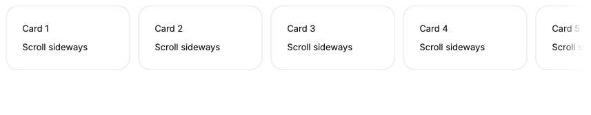

# Scroll view

Layout shows a strip of cards inside a horizontal viewport with an edge fade.
Horizontal scrolling and edge fades require the GUI host.
Available in **GUI and TUI**.



## Example

```pascal
unit Docs.Ui.Layout.ScrollView;

uses Fpas.Ui.Elements as E;
uses Fpas.Ui.Layout as L;

// Shows cards in a bounded horizontal viewport.
// ## Parameters
// - `Cards`: The row contents in display order.
// ## Returns
// A scroll view that owns its offset.
public function View(Cards: array of E.Element of string): E.Element of string;
begin
  return E.ScrollView of string(
    'previews',
    E.Row of string(new L.Flow(Gap := L.Spacing.Normal, Clip := false), Cards),
    new L.ScrollOptions(
      FadeEdges := true, Horizontal := true, Height := L.Extent.Fixed(L.Measure.Logical(150))
    )
  );
end function;

end unit;
```

## Options and defaults

| Option | Default or requirement |
| --- | --- |
| `ShowScrollbar / FadeEdges / Horizontal` | true / false / false. `Horizontal` enables scrolling on both axes. |
| `Width / Height` | Both fill by default. Supply GUI extents for content width, fixed size or percentage. CUI treats content height as fill. |
| `Padding / Gap` | GUI insets and spacing. Supply an array to stack direct children vertically with the specified gap. |
| `FadeColor` | GUI tint used when `FadeEdges` is enabled. CUI defaults to the nearest opaque background. |
| `Position / OnScroll` | Store the vertical position in the model and receive scroll proposals. GUI proposals use fractional logical points. |

## Interaction

Constrain the viewport along the scroll axis so overflow can scroll. In
the horizontal example, use horizontal wheel input or hold Shift while
turning a vertical scroll wheel. Drag the scrollbar to scroll vertically
when content overflows that axis.
For anchored navigation, let the host own the offset and put the outline
in the same CUI scope.

## See also

- [Widget API and types](../../../../src/Fpas.Ui/Elements.fpas)
- [Gallery example](../../../../examples/ui/gui/gallery/Pages/Layout/View.fpas)
- [Native scroll options test](../../../../tests/Fixtures/gui-host/ScrollOptionsContract.fpas)
- [Scroll anchor](../reader/scroll-anchor.md)
- [Chapter index](README.md)
- [Terminal example](../../tui/layout/scroll-view.md)
