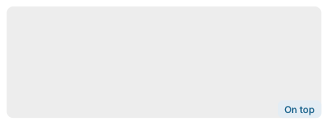

# Layered stack

Layout shows a blue badge over the bottom-right corner of a placeholder.
Available in **GUI**.



## Example

```pascal
unit Docs.Ui.Layout.Stack;

uses Fpas.Ui.Elements as E;
uses Fpas.Ui.Layout as L;
uses Fpas.Ui.Widgets.Containers.Stacks as W;
uses Fpas.Ui.Widgets.Feedback.Badges as Badge;
uses Fpas.Ui.Widgets.Feedback.Skeletons as Placeholder;

// Layers a badge over a placeholder.
// ## Returns
// A size-constrained stack with the badge painted last.
public function View(): E.Element<string>;
begin
  return E.Size<string>(
    W.Stack<string>(
      new L.Flow(Align := L.Alignment.End, Justify := L.Justification.End,
        Padding := L.Spacing.Fixed(L.Measure.Logical(12))),
      Placeholder.Skeleton<string>('preview-placeholder', Height := 140.0F),
      Badge.Badge<string>('preview-badge', 'On top')
    ),
    new L.Flex(
      Width := new L.AxisSize(Basis := L.Extent.Fill, Maximum := L.Measure.Logical(420)),
      Height := new L.AxisSize(Basis := L.Extent.Fixed(L.Measure.Logical(160)))
    )
  );
end function;

end unit;
```

## Options and defaults

| Option | Default or requirement |
| --- | --- |
| `Settings` | A Flow record. Align places children horizontally and Justify places them vertically. |
| `Children` | Specify children in paint order, with the topmost last. |

## Usage

Wrap the stack in `Elements.Size` when it needs a fixed height or maximum
width. The shared space lets a badge or other overlay cover part of the
content.

## See also

- [Widget API and types](../../../../src/Fpas.Ui/Widgets/Containers/Stacks.fpas)
- [Gallery example](../../../../examples/ui/gui/gallery/Pages/Layout/View.fpas)
- [Reading direction and spacing](reading-direction.md)
- [Chapter index](README.md)

## Source files

- [CuiLayoutOptionsTests.cs](../../../../tests/Fpas.Ui.Gui.Cui.Tests/Layout/CuiLayoutOptionsTests.cs)
