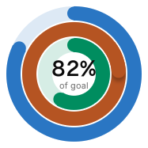

# Activity rings

Use concentric activity rings to compare progress on several goals.

Available in **GUI**.



## Example

```pascal
unit Docs.Ui.MoreCharts.ActivityRings;

uses Fpas.Ui.Elements as E;
uses Fpas.Ui.Widgets.Charts.ActivityRings as W;
uses Fpas.Ui.Widgets.Charts.Charts as C;

// Builds the activity rings example.
// ## Returns
// The widget for the application view.
public function View(): E.Element of string;
begin
  return W.ActivityRings of string('rings', [
    new C.Item('Move', 0.82F), new C.Item('Exercise', 1.24F), new C.Item('Stand', 0.58F)
  ], new W.Options(Size := 170.0F, Center := '82%', Caption := 'of goal'));
end function;

end unit;
```

## Options and defaults

| Option | Default or requirement |
| --- | --- |
| `Items` | Up to eight labeled nonnegative progress fractions. |
| `Size` | 0. CUI uses a 150-point diameter and can reduce the diameter in a narrow view. |
| `Thickness` | 0. CUI uses one tenth of the effective diameter, with a minimum of eight points. |
| `Center` | null. Use an empty string to show the caption alone. |
| `Caption` | null. An empty string keeps the caption space when `Center` is set. |
| `Legend / Enabled` | false / true. The legend shows names and percentages beside the rings. |

## Interaction

Values above `1` move the progress marker beyond the starting point, up to four turns. Hover over a visible ring or a legend row to inspect progress. The optional `OnActivate` callback receives the clicked item's input index. If an inner ring has insufficient space, its legend row still accepts clicks. [CUI-094](../../../future/cui-upstream-bugs.md#cui-094)

## See also

- [CUI widget inventory](../../../cui-widget-inventory.md#cui_sankey)
- [Widget API and types](../../../../src/Fpas.Ui/Widgets/Charts/ActivityRings.fpas)
- [Gallery example](../../../../examples/ui/gui/gallery/Pages/MoreCharts/Widgets/Flows.fpas)
- [Progress ring](../feedback/progress-ring.md)
- [More charts](README.md)

## Source files

- [ActivityRings.fpas](../../../../src/Fpas.Ui.Gui/Internal/Widgets/Charts/ActivityRings.fpas)
- [CuiWindow.ActivityRings.cs](../../../../src/Fpas.Ui.Gui.Cui/Widgets/Charts/CuiWindow.ActivityRings.cs)
- [activity_rings.c](../../../../src/Fpas.Ui.Gui.Cui/native/widgets/charts/activity_rings.c)
- [activity_rings.h](../../../../src/Fpas.Ui.Gui.Cui/native/widgets/charts/activity_rings.h)
