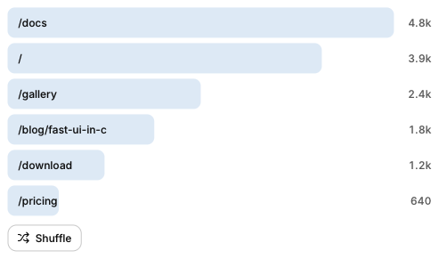

# Bar list

Use a bar list to show ranked amounts. The gallery's Shuffle button changes the amounts and CUI animates the change in rank.

Available in **GUI**.



## Example

```pascal
unit Docs.Ui.MoreCharts.BarList;

uses Fpas.Ui.Elements as E;
uses Fpas.Ui.Widgets.Charts.BarLists as W;
uses Fpas.Ui.Widgets.Charts.Charts as C;

// Builds the bar list example.
// ## Parameters
// - `Items`: Current values in input order.
// ## Returns
// The widget for the application view.
public function View(Items: array of C.Item): E.Element<int>;
begin
  return W.BarList<int>('pages', Items, new W.Options(MaximumRows := 5),
    function(Index: int): int => Index);
end function;

end unit;
```

## Options and defaults

| Option | Default or requirement |
| --- | --- |
| `Items` | Named nonnegative amounts. Give each item a unique stable label. |
| `MaximumRows / KeepOrder` | 0 / false. Zero shows every row. Enable KeepOrder to retain input order. |
| `Width / Format / Color / Enabled` | Fill / null / Automatic / true. An explicit color overrides the row colors. |

## Interaction

CUI sorts by amount by default and uses labels as animation keys as rows change rank. A click sends the original input index through `OnActivate`. Keep a label stable across updates for the same item.

## See also

- [Widget API and types](../../../../src/Fpas.Ui/Widgets/Charts/BarLists.fpas)
- [Gallery example](../../../../examples/ui/gui/gallery/Pages/MoreCharts/Widgets/Flows.fpas)
- [Bar chart](../charts/bar-chart.md)
- [More charts](README.md)

## Source files

- [BarList.fpas](../../../../src/Fpas.Ui.Gui/Internal/Widgets/Charts/BarList.fpas)
- [CuiWindow.BarList.cs](../../../../src/Fpas.Ui.Gui.Cui/Widgets/Charts/CuiWindow.BarList.cs)
- [bar_list.c](../../../../src/Fpas.Ui.Gui.Cui/native/widgets/charts/bar_list.c)
- [bar_list.h](../../../../src/Fpas.Ui.Gui.Cui/native/widgets/charts/bar_list.h)
