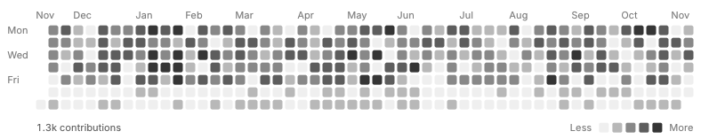

# Calendar heatmap

Use a calendar heatmap for one measurement per day. The gallery shows a year of contribution counts.

Available in **GUI**.



## Example

```pascal
unit Docs.Ui.MoreCharts.CalendarHeatmap;

uses Fpas.Ui.Elements as E;
uses Fpas.Ui.Widgets.Charts.CalendarHeatmaps as W;
uses System as Sys;

// Builds the calendar heatmap example.
// ## Parameters
// - `Start`: Date associated with the first value.
// - `Values`: Samples in display order.
// ## Returns
// The widget for the application view.
public function View(Start: Sys.DateOnly; Values: array of float): E.Element of Sys.DateOnly;
begin
  return W.CalendarHeatmap of Sys.DateOnly('activity', Start, Values,
    new W.Options(Unit := 'contributions'), function(Day: Sys.DateOnly): Sys.DateOnly => Day);
end function;

end unit;
```

## Options and defaults

| Option | Default or requirement |
| --- | --- |
| `Start / Values` | The first calendar date and finite daily values in date order. Nonpositive values leave empty squares. All dates must fit System.DateOnly. |
| `CellSize` | 0. CUI uses an 11-point square. Set a positive size in logical points for a different square size. |
| `Color` | Automatic. The CUI accent gives the highest step its color. Set a chart color to choose the top step. |
| `Format` | null. CUI uses compact numbers. A value format applies to the daily amount and to the displayed total. |
| `Unit` | Empty. Supply a unit to label the hover amount and show a total for the visible dates when space permits. |
| `Enabled` | true. Set false to disable pointer interaction. |

## Interaction

Hover a day for its date and amount. A click can send the actual date through `OnActivate`. Gaps between squares have no hover or activation. CUI shows the newest weeks that fit when space is narrow. The callback still identifies the corresponding original date.

## See also

- [CUI widget inventory](../../../cui-widget-inventory.md#cui_heatmap)
- [Widget API and types](../../../../src/Fpas.Ui/Widgets/Charts/CalendarHeatmaps.fpas)
- [Gallery example](../../../../examples/ui/gui/gallery/Pages/MoreCharts/View.fpas)
- [Heatmap](heatmap.md)
- [More charts](README.md)

## Source files

- [CalendarHeatmap.fpas](../../../../src/Fpas.Ui.Gui/Internal/Widgets/Charts/CalendarHeatmap.fpas)
- [CuiWindow.CalendarHeatmap.cs](../../../../src/Fpas.Ui.Gui.Cui/Widgets/Charts/CuiWindow.CalendarHeatmap.cs)
- [calendar_heatmap.c](../../../../src/Fpas.Ui.Gui.Cui/native/widgets/charts/calendar_heatmap.c)
- [calendar_heatmap.h](../../../../src/Fpas.Ui.Gui.Cui/native/widgets/charts/calendar_heatmap.h)
