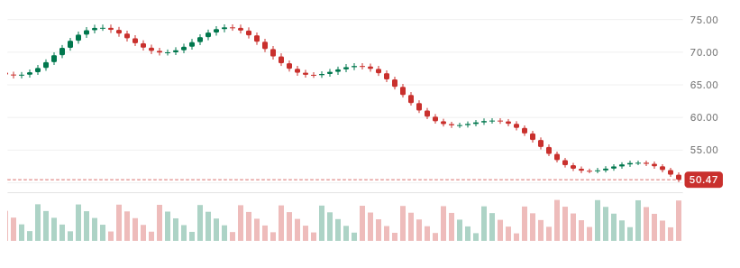

# Candlestick

Use a candlestick chart for ordered open, high, low and close values with optional volume. The gallery starts with 2,000 periods.

Available in **GUI**.



## Example

```pascal
unit Docs.Ui.MoreCharts.Candlestick;

uses Fpas.Ui.Elements as E;
uses Fpas.Ui.Widgets.Charts.Candlesticks as W;

// Builds the candlestick example.
// ## Parameters
// - `Candles`: OHLC periods in chronological order.
// ## Returns
// The widget for the application view.
public function View(Candles: array of W.Candle): E.Element of int;
begin
  return W.Candlestick of int('price', Candles, new W.Options(Height := 280.0F),
    function(Index: int): int => Index);
end function;

end unit;
```

## Options and defaults

| Option | Default or requirement |
| --- | --- |
| `Candles` | Pass finite values with High and Low enclosing Open and Close. Volume is nonnegative and defaults to zero. |
| `Labels` | Empty or one caption per period. A null entry omits the axis caption and uses the period number in the tooltip. |
| `Width / Height / Format` | Fill / 0 / null. Zero uses 320 logical units. A null price format uses two decimal places. |
| `Overlays` | Empty. Supply up to four lines with values in period order. NaN marks a gap. |
| `Volume / Ohlc / Enabled` | true / false / true. Enable Ohlc for bars instead of candle bodies. |
| `Up / Down` | Automatic uses the success and danger colors for rising and falling periods. |

## Interaction

Use the wheel to zoom around the pointer. Drag, use Shift+wheel or scroll
sideways to pan. Hover a candle to inspect its prices, the change from the
previous close and the volume when shown.

With focus, Left and Right move the crosshair. Hold Shift to move by ten
periods. Home and End go to the first and last periods. Plus and Minus
zoom. Zero fits all periods. A focus ring surrounds the plot during keyboard
navigation.

The chart follows appended periods while the newest period is visible.
`OnCursorChange` reports an index in the supplied periods, or minus one
when inspection clears. If the data shrinks, the keyboard cursor stays
within the remaining periods.

## See also

- [CUI widget inventory](../../../cui-widget-inventory.md#cui_sankey)
- [Widget API and types](../../../../src/Fpas.Ui/Widgets/Charts/Candlesticks.fpas)
- [Gallery example](../../../../examples/ui/gui/gallery/Pages/MoreCharts/Widgets/Market.fpas)
- [Line chart](../charts/line-chart.md)
- [More charts](README.md)

## Source files

- [Candlestick.fpas](../../../../src/Fpas.Ui.Gui/Internal/Widgets/Charts/Candlestick.fpas)
- [CuiWindow.Candlestick.cs](../../../../src/Fpas.Ui.Gui.Cui/Widgets/Charts/CuiWindow.Candlestick.cs)
- [candlestick.c](../../../../src/Fpas.Ui.Gui.Cui/native/widgets/charts/candlestick.c)
- [candlestick.h](../../../../src/Fpas.Ui.Gui.Cui/native/widgets/charts/candlestick.h)
