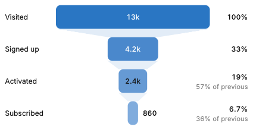

# Funnel

Use a funnel to show the amount that reaches each stage of a process. The gallery follows visits through subscription.

Available in **GUI**.



## Example

```pascal
unit Docs.Ui.MoreCharts.Funnel;

uses Fpas.Ui.Elements as E, Fpas.Ui.Widgets.Charts.Funnels as W,
  Fpas.Ui.Widgets.Charts.Charts as C;

// Builds the funnel example.
// ## Returns
// The widget for the application view.
public function View(): E.Element<string>;
begin
  return W.Funnel<string>('funnel', [
    new C.Item('Visited', 12840.0F), new C.Item('Signed up', 4210.0F),
    new C.Item('Activated', 2380.0F), new C.Item('Subscribed', 860.0F)
  ]);
end function;

end unit;
```

## Options and defaults

| Option | Default or requirement |
| --- | --- |
| `Items` | Named nonnegative counts in stage order with a finite sum. |
| `Width / Color / Format / Enabled` | Fill / Automatic / null / true. Color controls the base stage color. |

## Interaction

Hover a stage to inspect its amount. An optional `OnActivate` callback receives the stage's zero-based input index on a click.

## See also

- [Widget API and types](../../../../src/Fpas.Ui/Widgets/Charts/Funnels.fpas)
- [Gallery example](../../../../examples/ui/gui/gallery/Pages/MoreCharts/View.fpas)
- [Sankey](sankey.md)
- [More charts](README.md)
