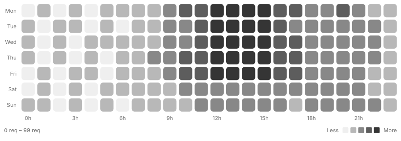

# Heatmap

Use a heatmap to compare values along two discrete axes. The gallery plots requests by weekday and hour.

Available in **GUI**.



## Example

```pascal
unit Docs.Ui.MoreCharts.Heatmap;

uses Fpas.Ui.Elements as E;
uses Fpas.Ui.Widgets.Charts.Charts as C;
uses Fpas.Ui.Widgets.Charts.Heatmaps as W;

// Builds the heatmap example.
// ## Returns
// The widget for the application view.
public function View(): E.Element of W.Cell;
begin
  return W.Heatmap of W.Cell('traffic', [12.0F, 30.0F, 18.0F, 8.0F, 24.0F, 21.0F], 2, 3,
    new W.Options(RowLabels := ['Mon', 'Tue'], ColumnLabels := ['09:00', '12:00', '15:00'],
      Format := new C.ValueFormat(Suffix := ' req')),
    function(Chosen: W.Cell): W.Cell => Chosen);
end function;

end unit;
```

## Options and defaults

| Option | Default or requirement |
| --- | --- |
| `Values / Rows / Columns` | Provide one finite value per cell in row-major order. A cell at Row and Column uses Values[Row * Columns + Column]. |
| `RowLabels / ColumnLabels` | Empty or one caption per row or column. Empty entries leave individual labels blank. |
| `Width` | Content. CUI fills the available width when `CellSize` is zero. An explicit cell size with Content gives the grid its intrinsic width. |
| `CellSize` | 0. Set a positive size in logical points to use fixed-size squares. |
| `Range` | null. CUI selects the scale from the data. Explicit bounds must be finite and increasing. |
| `Color` | Automatic. The CUI accent gives the highest step its color. Set a chart color to choose the top step. |
| `Format` | null. CUI uses compact numbers. A value format applies to the range and to hover values. |
| `Enabled` | true. Set false to disable pointer interaction. |

## Interaction

Hover a square to inspect its value. A click can send its zero-based row and column via `OnActivate`. Gaps between squares have no hover or activation. The heatmap stays outside keyboard focus traversal.

## See also

- [CUI widget inventory](../../../cui-widget-inventory.md#cui_heatmap)
- [Widget API and types](../../../../src/Fpas.Ui/Widgets/Charts/Heatmaps.fpas)
- [Gallery example](../../../../examples/ui/gui/gallery/Pages/MoreCharts/View.fpas)
- [Calendar heatmap](calendar-heatmap.md)
- [More charts](README.md)

## Source files

- [Heatmap.fpas](../../../../src/Fpas.Ui.Gui/Internal/Widgets/Charts/Heatmap.fpas)
- [CuiWindow.Heatmap.cs](../../../../src/Fpas.Ui.Gui.Cui/Widgets/Charts/CuiWindow.Heatmap.cs)
- [heatmap.c](../../../../src/Fpas.Ui.Gui.Cui/native/widgets/charts/heatmap.c)
- [heatmap.h](../../../../src/Fpas.Ui.Gui.Cui/native/widgets/charts/heatmap.h)
