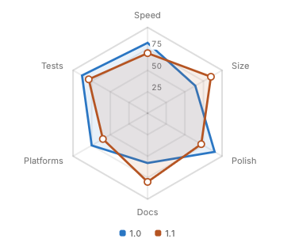

# Radar chart

Use a radar chart to compare several measurements for each of a few series on a common scale.

Available in **GUI**.



## Example

```pascal
unit Docs.Ui.MoreCharts.RadarChart;

uses Fpas.Ui.Elements as E;
uses Fpas.Ui.Widgets.Charts.Charts as C;
uses Fpas.Ui.Widgets.Charts.RadarCharts as W;

// Builds the radar chart example.
// ## Returns
// The widget for the application view.
public function View(): E.Element of string;
begin
  return W.RadarChart of string('radar', [
    new C.Series('1.0', [82.0F, 64.0F, 90.0F]),
    new C.Series('1.1', [70.0F, 85.0F, 72.0F])
  ], ['Speed', 'Size', 'Polish'], new W.Options(Size := 220.0F, Maximum := 100.0F));
end function;

end unit;
```

## Options and defaults

| Option | Default or requirement |
| --- | --- |
| `Axes / Series` | At least three axes. Each series provides one finite nonnegative value per axis in the same order. |
| `Size / Maximum` | 0 / 0. Zero uses the default diameter or automatic scale, respectively. |
| `Format / Legend / Enabled` | null / true / true. |

## Interaction

Hover to inspect values at an axis. Supply `OnActivate` to receive the zero-based axis index when CUI reports activation.

## See also

- [CUI widget inventory](../../../cui-widget-inventory.md#cui_heatmap)
- [Widget API and types](../../../../src/Fpas.Ui/Widgets/Charts/RadarCharts.fpas)
- [Gallery example](../../../../examples/ui/gui/gallery/Pages/MoreCharts/View.fpas)
- [Shared chart types](../../../../src/Fpas.Ui/Widgets/Charts/Charts.fpas)
- [More charts](README.md)

## Source files

- [RadarChart.fpas](../../../../src/Fpas.Ui.Gui/Internal/Widgets/Charts/RadarChart.fpas)
- [CuiWindow.RadarChart.cs](../../../../src/Fpas.Ui.Gui.Cui/Widgets/Charts/CuiWindow.RadarChart.cs)
- [radar_chart.c](../../../../src/Fpas.Ui.Gui.Cui/native/widgets/charts/radar_chart.c)
- [radar_chart.h](../../../../src/Fpas.Ui.Gui.Cui/native/widgets/charts/radar_chart.h)
