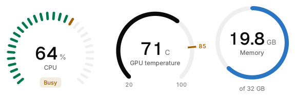

# Radial gauge

Use a radial gauge for a reading with an explicit scale, such as temperature or memory use. The gallery shows segments, an arc and a ring.

Available in **GUI**.



## Example

```pascal
unit Docs.Ui.MoreCharts.RadialGauge;

uses Fpas.Ui.Elements as E;
uses Fpas.Ui.Widgets.Charts.RadialGauges as W;

// Builds the radial gauge example.
// ## Parameters
// - `Temperature`: Current temperature in degrees Celsius.
// ## Returns
// The widget for the application view.
public function View(Temperature: float): E.Element of string;
begin
  return W.RadialGauge of string('temp', Temperature, 20.0F, 100.0F,
    new W.Options(Label := 'GPU temperature', Unit := 'C', Target := 85.0F, Size := 180.0F));
end function;

end unit;
```

## Options and defaults

| Option | Default or requirement |
| --- | --- |
| `Value / Minimum / Maximum` | Supply a finite value and finite increasing limits. CUI clamps the fill to the scale and displays the actual reading. |
| `Style / Bands` | Automatic uses Segments when bands are supplied and Arc otherwise. Arc, Segments and Ring can be selected explicitly. Provide up to 16 increasing thresholds within the scale. |
| `Band.Tone / Band.Name` | Neutral / empty. Segments use the band color and show the name when the value is in the band. |
| `Size / Sweep` | Zero uses a width of 200 logical units and a sweep of 270 degrees. An arc or segments use a sweep between 90 and 300 degrees. |
| `ShowLimits / Target` | True / null. An arc shows the limit captions and can draw a target marker. |
| `Label / Unit / Detail` | Empty. Add a caption, measurement unit or detail line to any style. |
| `Format` | Null. CUI uses its compact number format for the reading, limits and target. |
| `Color` | Automatic. Set the fill color explicitly. Bands still color their own segments. |

## Interaction

The gauge displays the current reading from the model. CUI animates the fill
as the reading changes. With reduced motion, the fill changes immediately.
A ring makes a full turn. The containing card receives pointer input over
the passive gauge.

## See also

- [CUI widget inventory](../../../cui-widget-inventory.md#cui_sankey)
- [Widget API and types](../../../../src/Fpas.Ui/Widgets/Charts/RadialGauges.fpas)
- [Gallery example](../../../../examples/ui/gui/gallery/Pages/MoreCharts/Widgets/Market.fpas)
- [Gauge](../charts/gauge.md)
- [More charts](README.md)

## Source files

- [RadialGauge.fpas](../../../../src/Fpas.Ui.Gui/Internal/Widgets/Charts/RadialGauge.fpas)
- [CuiWindow.RadialGauge.cs](../../../../src/Fpas.Ui.Gui.Cui/Widgets/Charts/CuiWindow.RadialGauge.cs)
- [radial_gauge.c](../../../../src/Fpas.Ui.Gui.Cui/native/widgets/charts/radial_gauge.c)
- [radial_gauge.h](../../../../src/Fpas.Ui.Gui.Cui/native/widgets/charts/radial_gauge.h)
