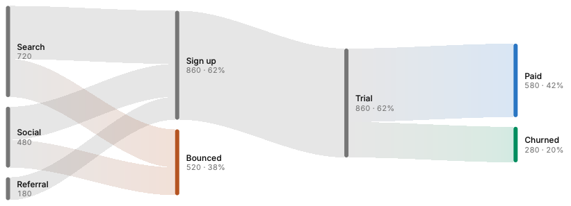

# Sankey

Use a Sankey diagram to show how amounts flow among named nodes. The gallery traces sign-ups from referral sources to outcomes.

Available in **GUI**.



## Example

```pascal
unit Docs.Ui.MoreCharts.Sankey;

uses Fpas.Ui.Elements as E, Fpas.Ui.Widgets.Charts.Sankeys as W;

// Builds the sankey example.
// ## Returns
// The widget for the application view.
public function View(): E.Element<W.Selection>;
begin
  return W.Sankey<W.Selection>('flow',
    [new W.Node('Search'), new W.Node('Sign up'), new W.Node('Trial'), new W.Node('Paid')],
    [new W.Link(0, 1, 420.0F), new W.Link(1, 2, 420.0F), new W.Link(2, 3, 260.0F)],
    new W.Options(Height := 280.0F), function(Item: W.Selection): W.Selection => Item);
end function;

end unit;
```

## Options and defaults

| Option | Default or requirement |
| --- | --- |
| `Nodes / Links` | Use named nodes and links with distinct From and To indices into the node array. Amounts must be finite and nonnegative. Zero hides a link. |
| `Width / Height / NodeWidth` | Fill / 0 / 0. Zero uses native dimensions. |
| `Format / Enabled` | null / true. |

## Interaction

Hover nodes and flows to inspect their amounts. A click can send `Selection.Node(Index)` or `Selection.Link(Index)`. Indices refer to the input arrays, including the positions of hidden zero-amount links.

## See also

- [Widget API and types](../../../../src/Fpas.Ui/Widgets/Charts/Sankeys.fpas)
- [Gallery example](../../../../examples/ui/gui/gallery/Pages/MoreCharts/Widgets/Flows.fpas)
- [Funnel](funnel.md)
- [More charts](README.md)
