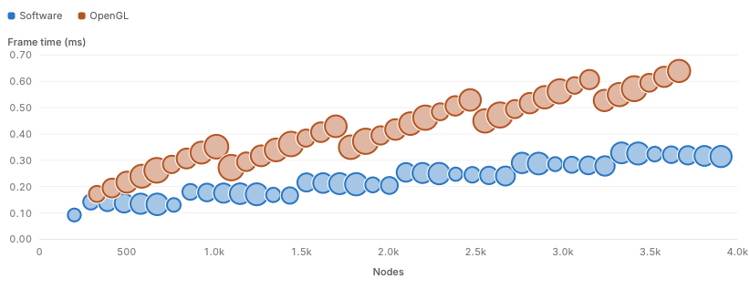

# Scatter chart

Use a scatter chart to compare two numeric coordinates. An optional bubble size adds a third measurement, such as draw calls.

Available in **GUI**.



## Example

```pascal
unit Docs.Ui.MoreCharts.ScatterChart;

uses Fpas.Ui.Elements as E;
uses Fpas.Ui.Widgets.Charts.Charts as C;
uses Fpas.Ui.Widgets.Charts.ScatterCharts as W;

// Builds the scatter chart example.
// ## Parameters
// - `Series`: Series in input order.
// ## Returns
// The widget for the application view.
public function View(Series: array of W.Series): E.Element of W.PointIndex;
begin
  return W.ScatterChart of W.PointIndex('scatter', Series,
    new W.Options(Height := 300.0F, XLabel := 'Nodes', YLabel := 'Frame time (ms)',
      YFormat := new C.ValueFormat(DecimalPlaces := 2)),
    function(Chosen: W.PointIndex): W.PointIndex => Chosen);
end function;

end unit;
```

## Options and defaults

| Option | Default or requirement |
| --- | --- |
| `Series / Sizes` | Supply named series with finite coordinates. Use no sizes for dots, or one finite nonnegative size per point for bubbles. |
| `Series.Color` | Automatic. CUI chooses the series color in input order. |
| `Width / Height` | Fill / 0. Zero uses 280 logical units. |
| `XLabel / YLabel` | Null omits the axis title and its space. An empty title keeps that space. |
| `XFormat / YFormat` | Null uses CUI's number format. Each format applies to the axis and tooltip. |
| `Legend / Enabled` | True / true. The legend appears with two or more series. |

## Interaction

Hover a point to inspect its coordinates. A click can send a typed `PointIndex` with the series and point positions from the input arrays.

## See also

- [CUI widget inventory](../../../cui-widget-inventory.md#cui_sankey)
- [Widget API and types](../../../../src/Fpas.Ui/Widgets/Charts/ScatterCharts.fpas)
- [Gallery example](../../../../examples/ui/gui/gallery/Pages/MoreCharts/Widgets/Market.fpas)
- [Shared chart types](../../../../src/Fpas.Ui/Widgets/Charts/Charts.fpas)
- [More charts](README.md)

## Source files

- [ScatterChart.fpas](../../../../src/Fpas.Ui.Gui/Internal/Widgets/Charts/ScatterChart.fpas)
- [CuiWindow.ScatterChart.cs](../../../../src/Fpas.Ui.Gui.Cui/Widgets/Charts/CuiWindow.ScatterChart.cs)
- [scatter_chart.c](../../../../src/Fpas.Ui.Gui.Cui/native/widgets/charts/scatter_chart.c)
- [scatter_chart.h](../../../../src/Fpas.Ui.Gui.Cui/native/widgets/charts/scatter_chart.h)
