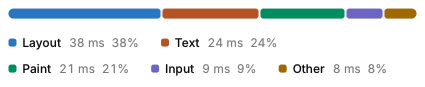

# Split bar

Use a split bar to show how categories divide a total along one track.

Available in **GUI**.



## Example

```pascal
unit Docs.Ui.MoreCharts.SplitBar;

uses Fpas.Ui.Elements as E;
uses Fpas.Ui.Widgets.Charts.Charts as C;
uses Fpas.Ui.Widgets.Charts.SplitBars as W;

// Builds the split bar example.
// ## Returns
// The widget for the application view.
public function View(): E.Element<string>;
begin
  return W.SplitBar<string>('split', [
    new C.Item('Layout', 38.0F), new C.Item('Text', 24.0F), new C.Item('Paint', 21.0F)
  ], new W.Options(Format := new C.ValueFormat(Suffix := ' ms')));
end function;

end unit;
```

## Options and defaults

| Option | Default or requirement |
| --- | --- |
| `Items` | Named nonnegative amounts with a finite sum. |
| `Width / Height` | Fill / 0. Zero height uses the CUI default. |
| `Format / Legend / Enabled` | null / true / true. |

## Interaction

Hover a segment or its legend entry to inspect the corresponding amount. Supply `OnActivate` to map a clicked segment's zero-based input index to a message.

## See also

- [Widget API and types](../../../../src/Fpas.Ui/Widgets/Charts/SplitBars.fpas)
- [Gallery example](../../../../examples/ui/gui/gallery/Pages/MoreCharts/View.fpas)
- [Donut chart](../charts/donut-chart.md)
- [Pattern meter](../charts/pattern-meter.md)
- [More charts](README.md)

## Source files

- [SplitBar.fpas](../../../../src/Fpas.Ui.Gui/Internal/Widgets/Charts/SplitBar.fpas)
- [CuiWindow.SplitBar.cs](../../../../src/Fpas.Ui.Gui.Cui/Widgets/Charts/CuiWindow.SplitBar.cs)
- [split_bar.c](../../../../src/Fpas.Ui.Gui.Cui/native/widgets/charts/split_bar.c)
- [split_bar.h](../../../../src/Fpas.Ui.Gui.Cui/native/widgets/charts/split_bar.h)
