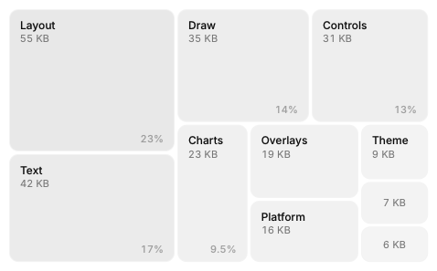

# Treemap

Use a treemap to compare the proportions of named values in a rectangular area. The gallery shows bundle size by module.

Available in **GUI**.



## Example

```pascal
unit Docs.Ui.MoreCharts.Treemap;

uses Fpas.Ui.Elements as E;
uses Fpas.Ui.Widgets.Charts.Charts as C;
uses Fpas.Ui.Widgets.Charts.Treemaps as W;

// Builds the treemap example.
// ## Parameters
// - `Selected`: Currently selected input index, or minus one.
// ## Returns
// The widget for the application view.
public function View(Selected: int): E.Element of int;
begin
  return W.Treemap of int('bundle', [
    new C.Item('Layout', 55.0F), new C.Item('Text', 42.0F), new C.Item('Draw', 35.0F)
  ], new W.Options(Height := 280.0F, Format := new C.ValueFormat(Suffix := ' KB')),
    Selected, function(Index: int): int => Index);
end function;

end unit;
```

## Options and defaults

| Option | Default or requirement |
| --- | --- |
| `Items` | Named nonnegative amounts with a finite sum. Each may supply a color. |
| `Width / Height / Format` | Fill / 0 / null. Zero height and a null format use CUI defaults. |
| `Selected / OnSelect` | -1 / null. Supply both the current index and the callback for selection. |
| `Enabled` | true. |

## Interaction

Hover a tile to inspect it. With a selection callback, clicking proposes the tile's input index. Clicking the selected tile proposes -1. Store the proposed index in the model. Omit the callback for hover-only inspection.

## See also

- [CUI widget inventory](../../../cui-widget-inventory.md#cui_heatmap)
- [Widget API and types](../../../../src/Fpas.Ui/Widgets/Charts/Treemaps.fpas)
- [Gallery example](../../../../examples/ui/gui/gallery/Pages/MoreCharts/View.fpas)
- [Shared chart types](../../../../src/Fpas.Ui/Widgets/Charts/Charts.fpas)
- [More charts](README.md)

## Source files

- [Treemap.fpas](../../../../src/Fpas.Ui.Gui/Internal/Widgets/Charts/Treemap.fpas)
- [CuiWindow.Treemap.cs](../../../../src/Fpas.Ui.Gui.Cui/Widgets/Charts/CuiWindow.Treemap.cs)
- [treemap.c](../../../../src/Fpas.Ui.Gui.Cui/native/widgets/charts/treemap.c)
- [treemap.h](../../../../src/Fpas.Ui.Gui.Cui/native/widgets/charts/treemap.h)
