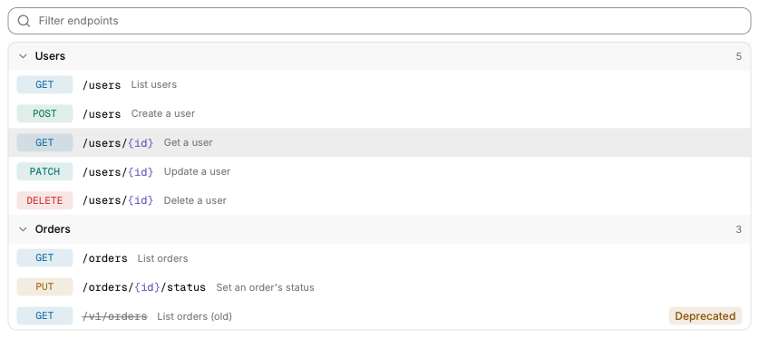

# API explorer

Use an API explorer to browse methods and paths grouped by tag. The
gallery shows Users and Orders, including a deprecated endpoint.
Available in **GUI**.



## Example

```pascal
unit Docs.Ui.MoreDeveloperTools.ApiExplorer;

uses Fpas.Ui.Elements as E;
uses Fpas.Ui.Widgets.Developer.ApiExplorers as W;

// Shows the API catalog loaded by the application.
// ## Parameters
// - `Endpoints`: Endpoints and their parameter metadata.
// - `Selected`: Selected endpoint index, or minus one.
// ## Returns
// The explorer with selection and Try it requests as messages.
public function View(Endpoints: array of W.Endpoint; Selected: int): E.Element of W.Event;
begin
  return W.ApiExplorer of W.Event('endpoints', Endpoints, Selected,
    function(Change: W.Event): W.Event => Change);
end function;

end unit;
```

## Options and defaults

| Option | Default or requirement |
| --- | --- |
| `Endpoint.Method / Path / Tag` | Supply method and path. A null tag groups the endpoint under Other. |
| `Deprecated / Parameters` | Deprecated draws a badge. Parameters supply names, locations, types, required flags and optional descriptions. |
| `Width / Height / Enabled` | Fill / 0 / true. |

## Interaction

Filter by path or summary, then open an endpoint to inspect its parameters.
Store `Event.Selection`. `TryIt` identifies an endpoint requested by
the user, or minus one. Use it to populate a request draft in your
application.

## See also

- [Widget API and types](../../../../src/Fpas.Ui/Widgets/Developer/ApiExplorers.fpas)
- [Gallery example](../../../../examples/ui/gui/gallery/Pages/MoreDeveloper/View.fpas)
- [HTTP request bar](http-request-bar.md)
- [More developer tools](README.md)

## Source files

- `src/Fpas.Ui.Gui/Internal/Widgets/Developer/`
  - [ApiExplorer.fpas](../../../../src/Fpas.Ui.Gui/Internal/Widgets/Developer/ApiExplorer.fpas)
- `src/Fpas.Ui.Gui.Cui/Interop/Developer/`
  - [NativeMethods.ApiExplorer.cs](../../../../src/Fpas.Ui.Gui.Cui/Interop/Developer/NativeMethods.ApiExplorer.cs)
- `src/Fpas.Ui.Gui.Cui/Widgets/Developer/`
  - [CuiWindow.ApiExplorer.cs](../../../../src/Fpas.Ui.Gui.Cui/Widgets/Developer/CuiWindow.ApiExplorer.cs)
- `src/Fpas.Ui.Gui.Cui/native/widgets/developer/`
  - [api_explorer.c](../../../../src/Fpas.Ui.Gui.Cui/native/widgets/developer/api_explorer.c)
  - [api_explorer.h](../../../../src/Fpas.Ui.Gui.Cui/native/widgets/developer/api_explorer.h)
