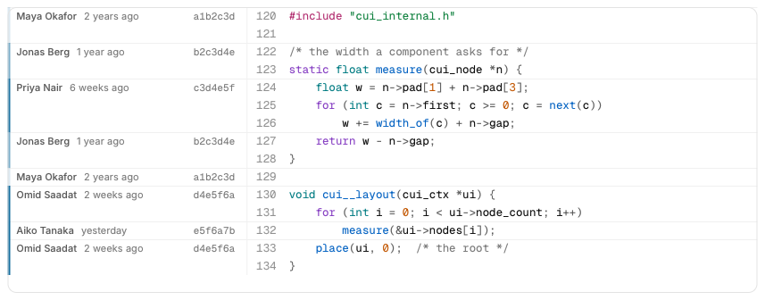

# Blame

Use Blame to show authors and revisions next to source lines. The
gallery highlights all lines associated with a gutter entry.
Available in **GUI**.



## Example

```pascal
unit Docs.Ui.MoreDeveloperTools.Blame;

uses Fpas.Ui.Elements as E;
uses Fpas.Ui.Widgets.Developer.Blames as W;

// Displays source with the revision that last changed each line.
// ## Parameters
// - `Lines`: Source lines in display order.
// - `LineCommits`: One revision index per source line.
// - `Revisions`: Hashes, authors, summaries and timestamps.
// ## Returns
// The blame view with clicked revisions as messages.
public function View(Lines: array of string; LineCommits: array of int; Revisions: array of W.Revision): E.Element of W.Event;
begin
  return W.Blame of W.Event('source-history', Lines, LineCommits, Revisions,
    function(Change: W.Event): W.Event => Change,
    new W.Options(Language := 'c', Height := 320.0F, FirstLine := 120));
end function;

end unit;
```

## Options and defaults

| Option | Default or requirement |
| --- | --- |
| `LineCommits` | Supply a zero-based revision index or minus one for each line. An empty array omits attribution. |
| `Revision.Hash / Author / Summary` | The gutter shows the author and up to seven hash characters. The tooltip shows the optional summary. |
| `Revision.Time` | Revision time in Unix seconds. Zero omits the age. |
| `Now` | Reference time in Unix seconds. Zero uses the system clock. |
| `Language` | Empty. Set a language to highlight source lines. |
| `FirstLine` | Zero. Values below one start numbering at one. |
| `Height` | Zero uses 360 logical units. A negative value fills the parent. |
| `Width / Enabled` | Fill / true. |

## Interaction

Hover over the gutter for a summary and to highlight the revision's lines.
The gutter uses a stronger shade for newer revisions and shows initials at
narrow widths.

The callback receives an `Event` when the hovered revision changes or when the
user clicks its gutter. `Hovered` and `Clicked` are zero-based revision indices.
Minus one indicates an absent revision. Use `Clicked` to open the revision in
your application's history view.

## See also

- [CUI widget inventory](../../../cui-widget-inventory.md#cui_blame)
- [Widget API and types](../../../../src/Fpas.Ui/Widgets/Developer/Blames.fpas)
- [Gallery example](../../../../examples/ui/gui/gallery/Pages/MoreDeveloper/View.fpas)
- [Commit graph](../developer-tools/commit-graph.md)
- [More developer tools](README.md)

## Source files

- `src/Fpas.Ui.Gui/Internal/Widgets/Developer/`
  - [Blame.fpas](../../../../src/Fpas.Ui.Gui/Internal/Widgets/Developer/Blame.fpas)
- `src/Fpas.Ui.Gui.Cui/Interop/Developer/`
  - [NativeMethods.Blame.cs](../../../../src/Fpas.Ui.Gui.Cui/Interop/Developer/NativeMethods.Blame.cs)
- `src/Fpas.Ui.Gui.Cui/Widgets/Developer/`
  - [CuiWindow.Blame.cs](../../../../src/Fpas.Ui.Gui.Cui/Widgets/Developer/CuiWindow.Blame.cs)
- `src/Fpas.Ui.Gui.Cui/native/widgets/developer/`
  - [blame.c](../../../../src/Fpas.Ui.Gui.Cui/native/widgets/developer/blame.c)
  - [blame.h](../../../../src/Fpas.Ui.Gui.Cui/native/widgets/developer/blame.h)
