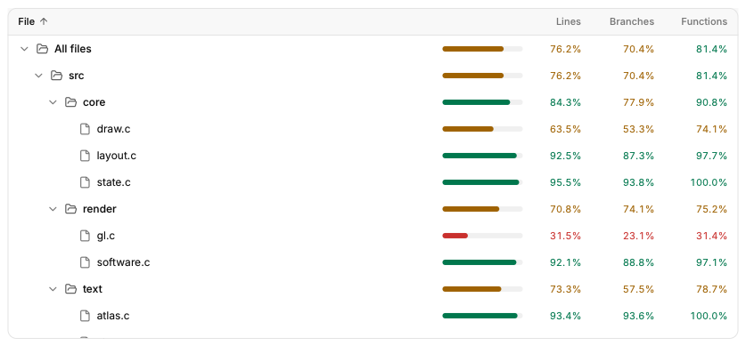

# Coverage

Use a coverage panel to summarize line, branch and function coverage.
The gallery derives a folder tree from the file paths.
Available in **GUI**.



## Example

```pascal
unit Docs.Ui.MoreDeveloperTools.Coverage;

uses Fpas.Ui.Elements as E;
uses Fpas.Ui.Widgets.Developer.Coverages as W;

// Shows a coverage report.
// ## Parameters
// - `Files`: Paths and total and covered counts.
// ## Returns
// The report with a message when a file is activated.
public function View(Files: array of W.File): E.Element of W.Event;
begin
  return W.Coverage of W.Event('coverage-report', Files,
    function(Change: W.Event): W.Event => Change, new W.Options(Height := 372.0F));
end function;

end unit;
```

## Options and defaults

| Option | Default or requirement |
| --- | --- |
| `File.Path / Lines / LinesHit` | Supply the path and nonnegative line totals and hits. Hits cannot exceed totals. |
| `Branches / BranchesHit / Functions / FunctionsHit` | Supply totals and hits for those measures. Use zero for unmeasured totals. |
| `Low / High` | Both zero. CUI defaults to 50 and 80 percent for the color thresholds. |
| `Width / Height / Enabled` | Fill / 0 / true. |

## Interaction

Fold folders or click a column heading to sort. CUI aggregates the files
in each directory. Enter or double-click activates a file. Use
`Event.Activated` to find its input row. `Lines` is the percentage of
covered lines in the whole report.

## See also

- [CUI widget inventory](../../../cui-widget-inventory.md#cui_coverage)
- [Widget API and types](../../../../src/Fpas.Ui/Widgets/Developer/Coverages.fpas)
- [Gallery example](../../../../examples/ui/gui/gallery/Pages/MoreDeveloper/View.fpas)
- [More developer tools](README.md)

## Source files

- `src/Fpas.Ui.Gui/Internal/Widgets/Developer/`
  - [Coverage.fpas](../../../../src/Fpas.Ui.Gui/Internal/Widgets/Developer/Coverage.fpas)
- `src/Fpas.Ui.Gui.Cui/Interop/Developer/`
  - [NativeMethods.Coverage.cs](../../../../src/Fpas.Ui.Gui.Cui/Interop/Developer/NativeMethods.Coverage.cs)
- `src/Fpas.Ui.Gui.Cui/Widgets/Developer/`
  - [CuiWindow.Coverage.cs](../../../../src/Fpas.Ui.Gui.Cui/Widgets/Developer/CuiWindow.Coverage.cs)
- `src/Fpas.Ui.Gui.Cui/native/widgets/developer/`
  - [coverage.c](../../../../src/Fpas.Ui.Gui.Cui/native/widgets/developer/coverage.c)
  - [coverage.h](../../../../src/Fpas.Ui.Gui.Cui/native/widgets/developer/coverage.h)
