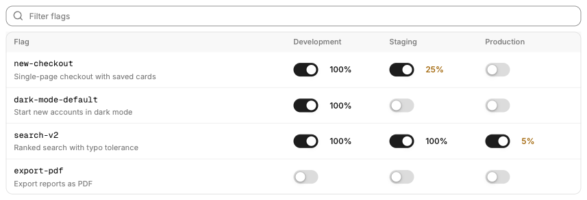

# Feature flags

Use a feature flags panel to compare a flag across environments. The
gallery shows switches and rollout shares for each environment.
Available in **GUI**.



## Example

```pascal
unit Docs.Ui.MoreDeveloperTools.FeatureFlags;

uses Fpas.Ui.Elements as E, Fpas.Ui.Widgets.Developer.FeatureFlagEditors as W;

// Displays feature flags from the current environment model.
// ## Parameters
// - `Flags`: Feature keys, descriptions and environment state.
// - `Environments`: Environment names in display order.
// ## Returns
// The editor with one flag change per proposal.
public function View(Flags: array of W.Flag; Environments: array of string): E.Element<W.Event>;
begin
  return W.FeatureFlags<W.Event>('rollout', Flags, Environments,
    function(Change: W.Event): W.Event => Change);
end function;

end unit;
```

## Options and defaults

| Option | Default or requirement |
| --- | --- |
| `Flag.On / Rollout` | Pass one switch and percentage per environment. While enabled, 0 and 100 mean the flag applies to everyone. |
| `Environments` | Supply up to eight environment names. |
| `Width / Height / Enabled` | Fill / 0 / true. Zero height fits the flag rows. |

## Interaction

Toggle an environment or click its share to edit it. Use `Event.Index`
and `Environment` to find the affected cell and store its `On` and
`Rollout` values. The view draws the resulting model.

## See also

- [Widget API and types](../../../../src/Fpas.Ui/Widgets/Developer/FeatureFlagEditors.fpas)
- [Gallery example](../../../../examples/ui/gui/gallery/Pages/MoreDeveloper/View.fpas)
- [More developer tools](README.md)
