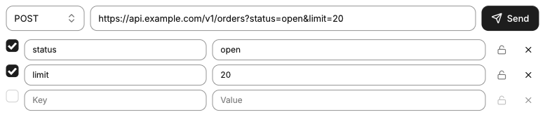

# HTTP request bar

Use a request bar for an HTTP draft. The gallery keeps its URL in sync
with a separate query-parameter editor.
Available in **GUI**.



## Example

```pascal
unit Docs.Ui.MoreDeveloperTools.HttpRequestBar;

uses Fpas.Ui.Elements as E;
uses Fpas.Ui.Widgets.Developer.RequestBars as W;

// Shows the current request draft and loading state.
// ## Parameters
// - `Method`: Current native HTTP method index.
// - `Url`: Current draft URL.
// - `Loading`: Whether an application request is in progress.
// ## Returns
// The request bar with edits and send or cancel intents.
public function View(Method: int; Url: string; Loading: bool): E.Element of W.Event;
begin
  return W.RequestBar of W.Event('request', Method, Url,
    function(Change: W.Event): W.Event => Change, new W.Options(Loading := Loading));
end function;

end unit;
```

## Options and defaults

| Option | Default or requirement |
| --- | --- |
| `Method` | 0 GET, 1 POST, 2 PUT, 3 PATCH, 4 DELETE, 5 HEAD, 6 OPTIONS. |
| `Capacity` | 255 UTF-8 bytes. |
| `Placeholder` | Null uses CUI's example URL. An empty string hides the caption. |
| `Loading` | False. True replaces Send with Cancel and suppresses submission from the URL field. |
| `Width` | Fill. The bar uses an icon for the action at narrow widths. |
| `Enabled` | True. False disables the method picker, URL field, and action. |

## Interaction

`Event.Changed` reports an edit to the method or URL. Store the method and URL
from the proposal. A nonempty URL enables Send and submission with Enter.
`Event.Send` and `Event.Cancel` report the action for the current loading state.
The application handles those actions. The gallery uses local sample data.

A host focus request for the widget ID focuses the URL field. Tab navigation
reaches the method picker, the URL field, and the enabled action.

## Query parameters

`Fpas.Ui.Gui.UrlParameters.Parse` converts the query into
`KeyValueEditors.Pair` values in URL order. The capacity limits the number of
pairs to a value from 0 to 4096. CUI decodes percent escapes and converts `+`
to a space. Each parsed pair starts enabled with its value visible.
CUI's key and value buffers hold up to 63 and 255 UTF-8 bytes respectively.
The GUI adapter omits a trailing partial UTF-8 sequence.

`Fpas.Ui.Gui.UrlParameters.Replace` uses CUI to encode the enabled pairs with
nonempty keys. The operation preserves the fragment and returns null if the
result exceeds the supplied capacity in UTF-8 bytes. Use the same capacity as
the request bar when the result becomes its URL. Both helpers operate on text.

## See also

- [CUI widget inventory](../../../cui-widget-inventory.md#cui_request_bar)
- [Widget API and types](../../../../src/Fpas.Ui/Widgets/Developer/RequestBars.fpas)
- [Gallery example](../../../../examples/ui/gui/gallery/Pages/MoreDeveloper/View.fpas)
- [HTTP response status](http-response-status.md)
- [Key-value editor](../developer-tools/key-value-editor.md)
- [Gallery update function](../../../../examples/ui/gui/gallery/Pages/MoreDeveloper/Update.fpas)
- [More developer tools](README.md)

## Source files

- `src/Fpas.Ui.Gui/Internal/Widgets/Developer/`
  - [RequestBar.fpas](../../../../src/Fpas.Ui.Gui/Internal/Widgets/Developer/RequestBar.fpas)
- `src/Fpas.Ui.Gui/`
  - [UrlParameters.fpas](../../../../src/Fpas.Ui.Gui/UrlParameters.fpas)
- `src/Fpas.Ui.Gui.Cui/Interop/Developer/`
  - [NativeMethods.RequestBar.cs](../../../../src/Fpas.Ui.Gui.Cui/Interop/Developer/NativeMethods.RequestBar.cs)
- `src/Fpas.Ui.Gui.Cui/Widgets/Developer/`
  - [CuiWindow.RequestBar.cs](../../../../src/Fpas.Ui.Gui.Cui/Widgets/Developer/CuiWindow.RequestBar.cs)
- `src/Fpas.Ui.Gui.Cui/native/widgets/developer/`
  - [request_bar.c](../../../../src/Fpas.Ui.Gui.Cui/native/widgets/developer/request_bar.c)
  - [request_bar.h](../../../../src/Fpas.Ui.Gui.Cui/native/widgets/developer/request_bar.h)
- `src/Fpas.Ui.Gui.Cui/native/tests/`
  - [http_tools.c](../../../../src/Fpas.Ui.Gui.Cui/native/tests/http_tools.c)
- `tests/Fpas.Ui.Gui.Cui.Tests/Developer/`
  - [CuiUrlParametersTests.cs](../../../../tests/Fpas.Ui.Gui.Cui.Tests/Developer/CuiUrlParametersTests.cs)
