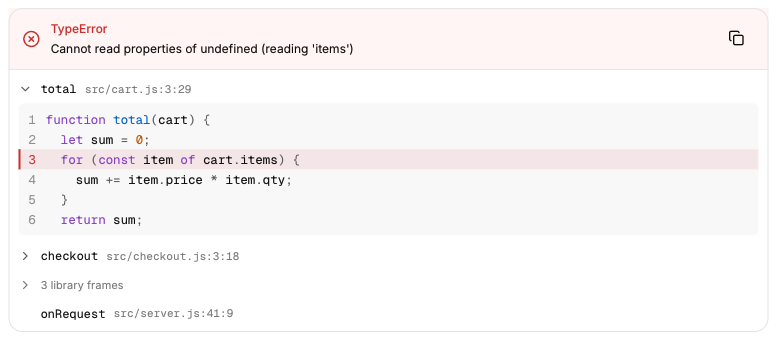

# Stack trace

Use a stack trace to inspect where an exception occurred. The gallery
shows a JavaScript error with source around the failing line.
Available in **GUI**.



## Example

```pascal
unit Docs.Ui.MoreDeveloperTools.StackTrace;

uses Fpas.Ui.Elements as E;
uses Fpas.Ui.Widgets.Developer.StackTraces as W;

// Displays a recorded runtime error.
// ## Parameters
// - `Frames`: Call stack in display order.
// - `Message`: Exception message from the application.
// ## Returns
// The trace panel with clicked frames as messages.
public function View(Frames: array of W.Frame; Message: string): E.Element of W.Event;
begin
  return W.StackTrace of W.Event('error-trace', Frames,
    function(Change: W.Event): W.Event => Change,
    new W.Options(Title := 'Runtime error', Message := Message, Language := 'js'));
end function;

end unit;
```

## Options and defaults

| Option | Default or requirement |
| --- | --- |
| `Frame.FunctionName` | A null or empty name displays as `<anonymous>`. |
| `Frame.File` | Optional file path. At narrow widths, the row shows the file name. |
| `Frame.Line / Column` | One-based. Zero omits the location component. |
| `Frame.External` | Consecutive external frames form one library group. |
| `Frame.Source / SourceFirst` | Preview lines and the display number of the first line. An empty array omits the preview. |
| `Title / Message` | Empty. Set these values to display the error header. |
| `Language` | Empty. Set a language to highlight source previews. |
| `Width / Enabled` | Fill / true. |

## Interaction

Library groups start folded. The first application frame with source starts
open on the initial trace. Click a row or use Enter or Space to toggle its preview
or group. The copy button copies the trace as text.

Activating a frame sends `Event.Clicked` with its zero-based input index. Use
the index to open the source in your application.

## See also

- [CUI widget inventory](../../../cui-widget-inventory.md#cui_stack_trace)
- [CUI clipboard truncation](../../../future/cui-upstream-bugs.md#cui-146)
- [CUI expansion state after trace replacement](../../../future/cui-upstream-bugs.md#cui-147)
- [Widget API and types](../../../../src/Fpas.Ui/Widgets/Developer/StackTraces.fpas)
- [Gallery example](../../../../examples/ui/gui/gallery/Pages/MoreDeveloper/View.fpas)
- [More developer tools](README.md)

## Source files

- `src/Fpas.Ui.Gui/Internal/Widgets/Developer/`
  - [StackTrace.fpas](../../../../src/Fpas.Ui.Gui/Internal/Widgets/Developer/StackTrace.fpas)
- `src/Fpas.Ui.Gui.Cui/Interop/Developer/`
  - [NativeMethods.StackTrace.cs](../../../../src/Fpas.Ui.Gui.Cui/Interop/Developer/NativeMethods.StackTrace.cs)
- `src/Fpas.Ui.Gui.Cui/Widgets/Developer/`
  - [CuiWindow.StackTrace.cs](../../../../src/Fpas.Ui.Gui.Cui/Widgets/Developer/CuiWindow.StackTrace.cs)
- `src/Fpas.Ui.Gui.Cui/native/widgets/developer/`
  - [stack_trace.c](../../../../src/Fpas.Ui.Gui.Cui/native/widgets/developer/stack_trace.c)
  - [stack_trace.h](../../../../src/Fpas.Ui.Gui.Cui/native/widgets/developer/stack_trace.h)
