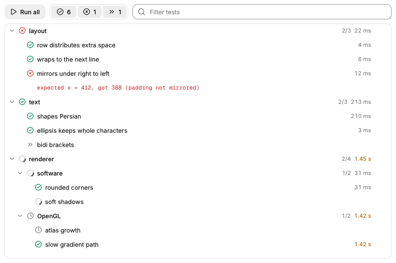

# Test explorer

Use a test explorer to show suites, results and failure details.
The gallery includes passing, failing and skipped tests.
Available in **GUI**.



## Example

```pascal
unit Docs.Ui.MoreDeveloperTools.TestExplorer;

uses Fpas.Ui.Elements as E;
uses Fpas.Ui.Widgets.Developer.TestExplorers as W;

// Displays the current test run.
// ## Parameters
// - `Items`: Tests and suites in tree order.
// ## Returns
// The explorer with test and source-navigation requests as messages.
public function View(Items: array of W.Item): E.Element of W.Event;
begin
  return W.TestExplorer of W.Event('test-results', Items,
    function(Change: W.Event): W.Event => Change, new W.Options(Height := 500.0F));
end function;

end unit;
```

## Options and defaults

| Option | Default or requirement |
| --- | --- |
| `Item.Name` | Display name used by the name filter. |
| `Item.Depth` | Zero through 63. List each suite before its children. Increase depth by at most one per row. |
| `Item.Status` | Use the pipeline status codes. Suites reflect the status of their tests. |
| `Item.Duration` | Seconds. A negative value indicates that the test has not run. |
| `Item.Message` | Optional failure details. The row displays the first line. |
| `Width` | Fill. |
| `Height` | Zero uses 320 logical units. A negative value fills the parent. |
| `Enabled` | True. |

## Interaction

Filter by name or status. Use Up and Down to select rows and Left and Right
to fold or expand suites. Press Enter to activate the selected row.

The callback receives an `Event` when selection or counts change, when a row
activates, or when the user asks to run tests. `Selected`, `Activated`, and `Run`
are zero-based item indices, with minus one for an absent item. `RunAll` requests
a full run. Handle execution and results in the application.

`Passed`, `Failed`, `Skipped`, and `Total` count tests across the full tree.
`Skipped` includes canceled tests. `Total` also includes pending and running tests.

## See also

- [CUI widget inventory](../../../cui-widget-inventory.md#cui_test_explorer)
- [CUI activation after filtering](../../../future/cui-upstream-bugs.md#cui-148)
- [Widget API and types](../../../../src/Fpas.Ui/Widgets/Developer/TestExplorers.fpas)
- [Gallery example](../../../../examples/ui/gui/gallery/Pages/MoreDeveloper/View.fpas)
- [Pipeline](../developer-tools/pipeline.md)
- [More developer tools](README.md)

## Source files

- `src/Fpas.Ui.Gui/Internal/Widgets/Developer/`
  - [TestExplorer.fpas](../../../../src/Fpas.Ui.Gui/Internal/Widgets/Developer/TestExplorer.fpas)
- `src/Fpas.Ui.Gui.Cui/Interop/Developer/`
  - [NativeMethods.TestExplorer.cs](../../../../src/Fpas.Ui.Gui.Cui/Interop/Developer/NativeMethods.TestExplorer.cs)
- `src/Fpas.Ui.Gui.Cui/Widgets/Developer/`
  - [CuiWindow.TestExplorer.cs](../../../../src/Fpas.Ui.Gui.Cui/Widgets/Developer/CuiWindow.TestExplorer.cs)
- `src/Fpas.Ui.Gui.Cui/native/widgets/developer/`
  - [test_explorer.c](../../../../src/Fpas.Ui.Gui.Cui/native/widgets/developer/test_explorer.c)
  - [test_explorer.h](../../../../src/Fpas.Ui.Gui.Cui/native/widgets/developer/test_explorer.h)
