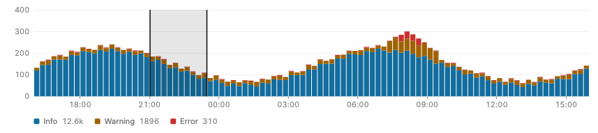

# Time histogram

Use a time histogram to see when events occurred. The gallery shows
several stacked series and a selected interval.
Available in **GUI**.



## Example

```pascal
unit Docs.Ui.MoreDeveloperTools.TimeHistogram;

uses Fpas.Ui.Elements as E;
uses Fpas.Ui.Widgets.Charts.TimeHistograms as W;

// Shows counts over a 24-hour window.
// ## Parameters
// - `Start`: Unix timestamp at the beginning of the window.
// - `Series`: Series with 96 counts of 15 minutes each.
// - `Selected`: Current selected interval.
// ## Returns
// The histogram with changes to the chosen interval as messages.
public function View(Start: double; Series: array of W.Series; Selected: W.Range): E.Element of W.Event;
begin
  return W.TimeHistogram of W.Event('event-time', Start, 900.0, 96, Series, Selected,
    function(Change: W.Event): W.Event => Change,
    new W.Options(Utc := true, Height := 150.0F));
end function;

end unit;
```

## Options and defaults

| Option | Default or requirement |
| --- | --- |
| `Start / Bucket / Buckets` | Start is Unix seconds. Bucket is the duration in seconds and Buckets is the number of buckets. |
| `Series.Name` | Supply the name shown in the legend and hover labels. |
| `Series.Counts` | Supply one nonnegative count per bucket, or null for all zeros. |
| `Series.Tone` | Zero uses the series palette. Values one through eight use CUI semantic tones. |
| `Utc` | False uses local time labels. True uses UTC labels. |
| `Width` | Fill. |
| `Height` | Zero uses the CUI plot height of 140 logical units. |
| `Enabled` | True. Set to false to suppress input. |
| `Hovered` | Null. To receive hover changes, pass the last reported bucket index. |

## Interaction

Drag across the bars to select whole buckets. Click to clear the interval.
When `Event.SelectionChanged` is true, save the proposed endpoints. Both
endpoints are zero for a cleared interval.

Hover a bucket to see its time and counts. To track hover, initialize
`Settings.Hovered` to minus one and save `Event.Hovered` in the model. The
index is zero-based. Minus one means the pointer is outside the buckets or
a selection drag is in progress.

## See also

- [CUI widget inventory](../../../cui-widget-inventory.md#cui_time_histogram)
- [Widget API and types](../../../../src/Fpas.Ui/Widgets/Charts/TimeHistograms.fpas)
- [Gallery example](../../../../examples/ui/gui/gallery/Pages/MoreDeveloper/View.fpas)
- [More charts](../more-charts/README.md)
- [More developer tools](README.md)

## Source files

- `src/Fpas.Ui.Gui/Internal/Widgets/Charts/`
  - [TimeHistogram.fpas](../../../../src/Fpas.Ui.Gui/Internal/Widgets/Charts/TimeHistogram.fpas)
- `src/Fpas.Ui.Gui.Cui/Interop/Charts/`
  - [NativeMethods.TimeHistogram.cs](../../../../src/Fpas.Ui.Gui.Cui/Interop/Charts/NativeMethods.TimeHistogram.cs)
- `src/Fpas.Ui.Gui.Cui/Widgets/Charts/`
  - [CuiWindow.TimeHistogram.cs](../../../../src/Fpas.Ui.Gui.Cui/Widgets/Charts/CuiWindow.TimeHistogram.cs)
- `src/Fpas.Ui.Gui.Cui/native/widgets/charts/`
  - [time_histogram.c](../../../../src/Fpas.Ui.Gui.Cui/native/widgets/charts/time_histogram.c)
  - [time_histogram.h](../../../../src/Fpas.Ui.Gui.Cui/native/widgets/charts/time_histogram.h)
