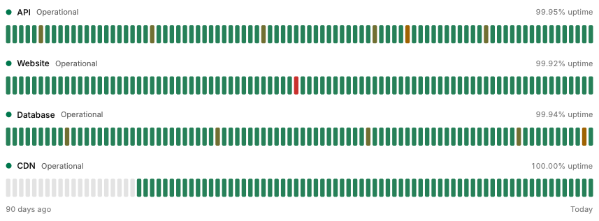

# Uptime bars

Use uptime bars for a service status page. The gallery shows a row per
service, with each bar representing one day.
Available in **GUI**.



## Example

```pascal
unit Docs.Ui.MoreDeveloperTools.Uptime;

uses Fpas.Ui.Elements as E;
uses Fpas.Ui.Widgets.Developer.Uptimes as W;
uses System as Sys;

// Displays the latest availability history.
// ## Parameters
// - `Services`: Service names and daily availability, oldest first.
// - `LastDay`: Date corresponding to the newest sample.
// ## Returns
// The availability panel for the application view.
public function View(Services: array of W.Service; LastDay: Sys.DateOnly): E.Element of string;
begin
  return W.Uptime of string('availability', Services, LastDay);
end function;

end unit;
```

## Options and defaults

| Option | Default or requirement |
| --- | --- |
| `Service.Days` | Use fractions from zero through one. Negative samples represent missing data. |
| `LastDay` | Supply the date of the last value so hover labels can resolve earlier dates. |
| `Width / Enabled` | Fill / true. |

## Interaction

Hover a bar to see its date and availability. Narrow panels retain the
most recent days that fit. Pass fresh samples when the application
updates the service history.

## See also

- [CUI widget inventory](../../../cui-widget-inventory.md#cui_uptime)
- [Widget API and types](../../../../src/Fpas.Ui/Widgets/Developer/Uptimes.fpas)
- [Gallery example](../../../../examples/ui/gui/gallery/Pages/MoreDeveloper/View.fpas)
- [More developer tools](README.md)

## Source files

- `src/Fpas.Ui.Gui/Internal/Widgets/Developer/`
  - [Uptime.fpas](../../../../src/Fpas.Ui.Gui/Internal/Widgets/Developer/Uptime.fpas)
- `src/Fpas.Ui.Gui.Cui/Interop/Developer/`
  - [NativeMethods.Uptime.cs](../../../../src/Fpas.Ui.Gui.Cui/Interop/Developer/NativeMethods.Uptime.cs)
- `src/Fpas.Ui.Gui.Cui/Widgets/Developer/`
  - [CuiWindow.Uptime.cs](../../../../src/Fpas.Ui.Gui.Cui/Widgets/Developer/CuiWindow.Uptime.cs)
- `src/Fpas.Ui.Gui.Cui/native/widgets/developer/`
  - [uptime.c](../../../../src/Fpas.Ui.Gui.Cui/native/widgets/developer/uptime.c)
  - [uptime.h](../../../../src/Fpas.Ui.Gui.Cui/native/widgets/developer/uptime.h)
