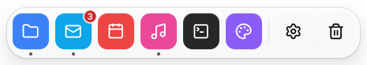

# Dock

Use a dock to present a row of shortcuts with optional status indicators.
Available in **GUI**.



## Example

```pascal
unit Docs.Ui.Motion.Dock;

uses Fpas.Ui.Elements as E;
uses Fpas.Ui.Widgets.Charts.Charts as C;
uses Fpas.Ui.Widgets.Navigation.Docks as W;
uses System as Sys;

// Shows a small application dock.
// ## Parameters
// - `FilesRunning`: Whether to show the running dot on Files.
// ## Returns
// The dock with a message when Files is opened.
public function View(FilesRunning: bool): E.Element of string;
begin
  return W.Dock of string('dock', [
    (W.Entry of string).Item(Sys.Char.ConvertFromUtf32($E0D7), 'Files', 'open-files',
      C.Color.Automatic, FilesRunning, 0)
  ]);
end function;

end unit;
```

## Options and defaults

| Option | Default or requirement |
| --- | --- |
| `Entry.Item` | An optional glyph and tooltip, an activation message, and appearance. Null omits the glyph or tooltip. |
| `Entry.Separator` | Divides groups. |
| `Color` | The background color. Use `Automatic` for the native theme colors. |
| `Running / Badge` | `Running` draws a dot. A positive `Badge` shows a count and values above 99 display `99+`. |
| `Size / Magnify` | 0 / 0. The native defaults are 46 points and 1.55. |
| `Enabled` | true. Accepts pointer and keyboard activation. |

## Interaction

Move the pointer across icons to magnify them. The dock uses the viewport
width to reduce icon size and remove magnification in narrow windows. Click
an item, or focus it and press Enter or Space, to send its activation message.

## See also

- [CUI widget inventory](../../../cui-widget-inventory.md#cui_dock)
- [Widget API and types](../../../../src/Fpas.Ui/Widgets/Navigation/Docks.fpas)
- [Gallery example](../../../../examples/ui/gui/gallery/Pages/Motion/Controls.fpas)
- [Tab bar](tab-bar.md)
- [Motion](README.md)

## Source files

- `src/Fpas.Ui.Gui/Internal/Widgets/Navigation/`
  - [Dock.fpas](../../../../src/Fpas.Ui.Gui/Internal/Widgets/Navigation/Dock.fpas)
- `src/Fpas.Ui.Gui.Cui/Interop/Navigation/`
  - [NativeMethods.Dock.cs](../../../../src/Fpas.Ui.Gui.Cui/Interop/Navigation/NativeMethods.Dock.cs)
- `src/Fpas.Ui.Gui.Cui/Widgets/Navigation/`
  - [CuiWindow.Dock.cs](../../../../src/Fpas.Ui.Gui.Cui/Widgets/Navigation/CuiWindow.Dock.cs)
- `src/Fpas.Ui.Gui.Cui/native/widgets/navigation/`
  - [dock.c](../../../../src/Fpas.Ui.Gui.Cui/native/widgets/navigation/dock.c)
  - [dock.h](../../../../src/Fpas.Ui.Gui.Cui/native/widgets/navigation/dock.h)
