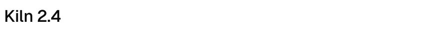

# Gradient text

The gallery draws the Kiln heading with an animated gradient.
Available in **GUI**.



## Example

```pascal
unit Docs.Ui.Motion.GradientText;

uses Fpas.Ui.Elements as E;
uses Fpas.Ui.Widgets.Motion.GradientTexts as W;
uses Fpas.Ui.Widgets.Motion.Motion as M;

// Draws a release heading.
// ## Parameters
// - `Title`: Heading text.
// ## Returns
// The native gradient text.
public function View(Title: string): E.Element of string;
begin
  return W.GradientText of string('release-title', Title,
    new W.Options(Font := M.Font.Display, Size := 34.0F, Animate := true));
end function;

end unit;
```

## Options and defaults

| Option | Default or requirement |
| --- | --- |
| `Font` | Body. |
| `Size` | Zero uses the theme's body text size. |
| `Width` | Content. Supply a width to wrap the text. |
| `From` | Automatic uses the accent or the foreground color with a neutral accent. |
| `To` | Automatic blends the first color toward the foreground. |
| `Animate` | False. Set True to move the gradient along the text. |

## Interaction

The static gradient runs from `From` at the left to `To` at the right.
The animated gradient repeats a forward and reverse blend to make the loop
continuous. Reduced motion shows the first phase of the animated gradient.

## See also

- [CUI widget inventory](../../../cui-widget-inventory.md#cui_gradient_text)
- [Widget API and types](../../../../src/Fpas.Ui/Widgets/Motion/GradientTexts.fpas)
- [Gallery example](../../../../examples/ui/gui/gallery/Pages/Motion/View.fpas)
- [Motion](README.md)

## Source files

- `src/Fpas.Ui.Gui/Internal/Widgets/Motion/`
  - [GradientText.fpas](../../../../src/Fpas.Ui.Gui/Internal/Widgets/Motion/GradientText.fpas)
- `src/Fpas.Ui.Gui.Cui/Interop/Motion/`
  - [NativeMethods.GradientText.cs](../../../../src/Fpas.Ui.Gui.Cui/Interop/Motion/NativeMethods.GradientText.cs)
- `src/Fpas.Ui.Gui.Cui/Widgets/Motion/`
  - [CuiWindow.GradientText.cs](../../../../src/Fpas.Ui.Gui.Cui/Widgets/Motion/CuiWindow.GradientText.cs)
- `src/Fpas.Ui.Gui.Cui/native/widgets/motion/`
  - [gradient_text.c](../../../../src/Fpas.Ui.Gui.Cui/native/widgets/motion/gradient_text.c)
  - [gradient_text.h](../../../../src/Fpas.Ui.Gui.Cui/native/widgets/motion/gradient_text.h)
