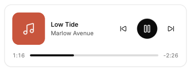

# Now playing

The gallery plays a simulated track with artwork and a seek bar.
Available in **GUI**.



## Example

```pascal
unit Docs.Ui.Motion.NowPlaying;

uses Fpas.Ui.Elements as E;
uses Fpas.Ui.Widgets.Audio.NowPlaying as W;

// Shows a model-owned track and transport state.
// ## Parameters
// - `Track`: Track title, artist, playback and artwork.
// ## Returns
// The player with transport and seek proposals.
public function View(Track: W.Value): E.Element of W.Event;
begin
  return W.NowPlaying of W.Event('player', Track, function(Change: W.Event): W.Event => Change);
end function;

end unit;
```

## Options and defaults

| Option | Default or requirement |
| --- | --- |
| `Title / Artist` | Pass the track labels. |
| `Position / Duration` | Pass seconds. Position ranges from zero to duration. |
| `Playing / ArtColor / Artwork` | false / Automatic / null. Use a file or an RGBA image source for custom artwork. The art color sets the tile background. |
| `Width / Compact / Enabled` | Content / false / true. CUI prefers 360 points in regular mode and 340 points in compact mode. Compact mode uses smaller artwork and omits Previous. The regular card also uses smaller artwork and omits Previous when its width is below 300 points. |

## Interaction

Tab to the available transport buttons and activate them with Enter or Space.
Click or drag the seek bar to preview a position. Releasing the pointer
proposes that position. Apply the proposed play state or position, handle
Previous and Next, and supply updated position as playback runs.

## See also

- [CUI widget inventory](../../../cui-widget-inventory.md#cui_now_playing)
- [Widget API and types](../../../../src/Fpas.Ui/Widgets/Audio/NowPlaying.fpas)
- [Gallery example](../../../../examples/ui/gui/gallery/Pages/Motion/Controls.fpas)
- [Image sources](../text-and-display/image.md)
- [Waveform](waveform.md)
- [Motion](README.md)

## Source files

- `src/Fpas.Ui.Gui/Internal/Widgets/Audio/`
  - [NowPlaying.fpas](../../../../src/Fpas.Ui.Gui/Internal/Widgets/Audio/NowPlaying.fpas)
- `src/Fpas.Ui.Gui.Cui/Interop/Audio/`
  - [NativeMethods.NowPlaying.cs](../../../../src/Fpas.Ui.Gui.Cui/Interop/Audio/NativeMethods.NowPlaying.cs)
- `src/Fpas.Ui.Gui.Cui/Widgets/Audio/`
  - [CuiWindow.NowPlaying.Types.cs](../../../../src/Fpas.Ui.Gui.Cui/Widgets/Audio/CuiWindow.NowPlaying.Types.cs)
  - [CuiWindow.NowPlaying.cs](../../../../src/Fpas.Ui.Gui.Cui/Widgets/Audio/CuiWindow.NowPlaying.cs)
- `src/Fpas.Ui.Gui.Cui/native/widgets/audio/`
  - [now_playing.c](../../../../src/Fpas.Ui.Gui.Cui/native/widgets/audio/now_playing.c)
  - [now_playing.h](../../../../src/Fpas.Ui.Gui.Cui/native/widgets/audio/now_playing.h)
