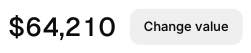
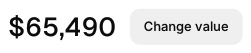

# Rolling number

The gallery changes between two formatted currency totals. Only changed
digits roll.
Available in **GUI**.



## Example

```pascal
unit Docs.Ui.Motion.RollingNumber;

uses Fpas.Ui.Elements as E, Fpas.Ui.Widgets.Motion.NumberRolls as W, Fpas.Ui.Widgets.Motion.Motion as M;

// Displays a preformatted total.
// ## Parameters
// - `Total`: Formatted amount with any prefix or grouping.
// ## Returns
// The native rolling figure.
public function View(Total: string): E.Element<string>;
begin
  return W.NumberRoll<string>('total', Total,
    new M.TextOptions(Font := M.Font.Display, Size := 26.0F));
end function;

end unit;
```

## Options and defaults

| Option | Default or requirement |
| --- | --- |
| `Text` | Format the value in the application. CUI draws tabular digits. |
| `Font / Size / Color` | Body / 0 / Automatic. |

## Interaction

Keep the ID stable when the text changes to animate the changed digits.
Long values beyond the native animation capacity appear as complete
tabular text.



## See also

- [Widget API and types](../../../../src/Fpas.Ui/Widgets/Motion/NumberRolls.fpas)
- [Gallery example](../../../../examples/ui/gui/gallery/Pages/Motion/View.fpas)
- [Counter](../social-and-media/counter.md)
- [Motion](README.md)

## Source files

- `src/Fpas.Ui.Gui/Internal/Widgets/Motion/`
  - [NumberRoll.fpas](../../../../src/Fpas.Ui.Gui/Internal/Widgets/Motion/NumberRoll.fpas)
- `src/Fpas.Ui.Gui.Cui/Interop/Motion/`
  - [NativeMethods.NumberRoll.cs](../../../../src/Fpas.Ui.Gui.Cui/Interop/Motion/NativeMethods.NumberRoll.cs)
- `src/Fpas.Ui.Gui.Cui/Widgets/Motion/`
  - [CuiWindow.NumberRoll.cs](../../../../src/Fpas.Ui.Gui.Cui/Widgets/Motion/CuiWindow.NumberRoll.cs)
- `src/Fpas.Ui.Gui.Cui/native/widgets/motion/`
  - [number_roll.c](../../../../src/Fpas.Ui.Gui.Cui/native/widgets/motion/number_roll.c)
  - [number_roll.h](../../../../src/Fpas.Ui.Gui.Cui/native/widgets/motion/number_roll.h)
