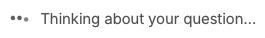

# Shimmer text

The gallery pairs a shimmer with a dots loader while a task is pending.
Available in **GUI**.



## Example

```pascal
unit Docs.Ui.Motion.ShimmerText;

uses Fpas.Ui.Elements as E;
uses Fpas.Ui.Widgets.Motion.Motion as M;
uses Fpas.Ui.Widgets.Motion.ShimmerTexts as W;

// Displays the current waiting message.
// ## Parameters
// - `Caption`: Visible waiting message.
// ## Returns
// The native shimmer text.
public function View(Caption: string): E.Element<string>;
begin
  return W.ShimmerText<string>('thinking', Caption, new M.TextOptions(Size := 15.0F));
end function;

end unit;
```

## Options and defaults

| Option | Default or requirement |
| --- | --- |
| `Font / Size / Color` | Body / 0 / Automatic. Zero size uses native text size. |
| `Speed` | 0. Positive values are sweeps per second. |

## Interaction

Render the message while the task is pending. CUI draws a moving
highlight, and reduced motion leaves the text readable without the
movement.

## See also

- [Widget API and types](../../../../src/Fpas.Ui/Widgets/Motion/ShimmerTexts.fpas)
- [Gallery example](../../../../examples/ui/gui/gallery/Pages/Motion/View.fpas)
- [Loader](loader.md)
- [Motion](README.md)

## Source files

- `src/Fpas.Ui.Gui/Internal/Widgets/Motion/`
  - [ShimmerText.fpas](../../../../src/Fpas.Ui.Gui/Internal/Widgets/Motion/ShimmerText.fpas)
- `src/Fpas.Ui.Gui.Cui/Interop/Motion/`
  - [NativeMethods.ShimmerText.cs](../../../../src/Fpas.Ui.Gui.Cui/Interop/Motion/NativeMethods.ShimmerText.cs)
- `src/Fpas.Ui.Gui.Cui/Widgets/Motion/`
  - [CuiWindow.ShimmerText.cs](../../../../src/Fpas.Ui.Gui.Cui/Widgets/Motion/CuiWindow.ShimmerText.cs)
- `src/Fpas.Ui.Gui.Cui/native/widgets/motion/`
  - [shimmer_text.c](../../../../src/Fpas.Ui.Gui.Cui/native/widgets/motion/shimmer_text.c)
  - [shimmer_text.h](../../../../src/Fpas.Ui.Gui.Cui/native/widgets/motion/shimmer_text.h)
