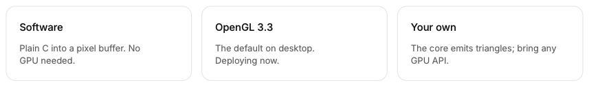

# Spotlight card

The gallery uses three cards and enables the traveling beam on the
OpenGL card.
Available in **GUI**.



## Example

```pascal
unit Docs.Ui.Motion.SpotlightCard;

uses Fpas.Ui.Elements as E;
uses Fpas.Ui.Widgets.Motion.Spotlights as W;

// Wraps a renderer description in a spotlight card.
// ## Parameters
// - `Heading`: Card title.
// - `Detail`: Card description.
// - `Active`: Whether to draw the beam.
// ## Returns
// The card with its supplied contents.
public function View(Heading: string; Detail: string; Active: bool): E.Element<string>;
begin
  return W.Spotlight<string>('renderer', [E.Text<string>(Heading), E.Text<string>(Detail)],
    new W.Options(Beam := Active));
end function;

end unit;
```

## Options and defaults

| Option | Default or requirement |
| --- | --- |
| `Width / Height` | Fill / Content. |
| `Padding / Gap / Color` | 0 / 0 / Automatic. Zero uses the native inset or spacing. |
| `Beam` | false. Draws a moving light around the edge. |

## Interaction

Move the pointer across the card to light the nearby edge. Supply
child widgets for any actions the card contains.

## See also

- [Widget API and types](../../../../src/Fpas.Ui/Widgets/Motion/Spotlights.fpas)
- [Gallery example](../../../../examples/ui/gui/gallery/Pages/Motion/View.fpas)
- [Motion](README.md)

## Source files

- `src/Fpas.Ui.Gui/Internal/Widgets/Motion/`
  - [Spotlight.fpas](../../../../src/Fpas.Ui.Gui/Internal/Widgets/Motion/Spotlight.fpas)
- `src/Fpas.Ui.Gui.Cui/Interop/Motion/`
  - [NativeMethods.Spotlight.cs](../../../../src/Fpas.Ui.Gui.Cui/Interop/Motion/NativeMethods.Spotlight.cs)
- `src/Fpas.Ui.Gui.Cui/Widgets/Motion/`
  - [CuiWindow.Spotlight.cs](../../../../src/Fpas.Ui.Gui.Cui/Widgets/Motion/CuiWindow.Spotlight.cs)
- `src/Fpas.Ui.Gui.Cui/native/widgets/motion/`
  - [spotlight.c](../../../../src/Fpas.Ui.Gui.Cui/native/widgets/motion/spotlight.c)
  - [spotlight.h](../../../../src/Fpas.Ui.Gui.Cui/native/widgets/motion/spotlight.h)
