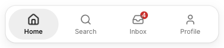

# Tab bar

Use a tab bar to navigate between views in a compact layout.
Available in **GUI**.



## Example

```pascal
unit Docs.Ui.Motion.TabBar;

uses Fpas.Ui.Elements as E;
uses Fpas.Ui.Widgets.Navigation.TabBars as W;

// Shows navigation tabs for a compact view.
// ## Parameters
// - `Tabs`: Icons, captions and badge counts in display order.
// - `Selected`: Selected zero-based index or -1 for no selection.
// ## Returns
// The bar with a proposed tab index.
public function View(Tabs: array of W.Item; Selected: int): E.Element of int;
begin
  return W.TabBar of int('bottom-tabs', Tabs, Selected, function(Index: int): int => Index);
end function;

end unit;
```

## Options and defaults

| Option | Default or requirement |
| --- | --- |
| `Item.Icon` | A CUI glyph. Null uses a circle. Use an empty string to omit the glyph. |
| `Item.Label` | Literal text. Null omits the label row. |
| `Item.Badge` | 0 hides the badge. Values above 9 display `9+`. |
| `Selected` | A zero-based index or -1 for no selection. |
| `Width / LabelsOnSelection / Enabled` | Fill / false / true. `LabelsOnSelection` shows only the selected label. |

## Interaction

Click a tab or use Left and Right from a focused tab to propose a selection.
Enter or Space proposes the focused tab. Apply the proposed index to the
model and display its view. The bar animates the selection indicator.

## See also

- [CUI widget inventory](../../../cui-widget-inventory.md#cui_tab_bar)
- [Widget API and types](../../../../src/Fpas.Ui/Widgets/Navigation/TabBars.fpas)
- [Gallery example](../../../../examples/ui/gui/gallery/Pages/Motion/Controls.fpas)
- [Tabs](../navigation/tabs.md)
- [Motion](README.md)

## Source files

- `src/Fpas.Ui.Gui/Internal/Widgets/Navigation/`
  - [TabBar.fpas](../../../../src/Fpas.Ui.Gui/Internal/Widgets/Navigation/TabBar.fpas)
- `src/Fpas.Ui.Gui.Cui/Interop/Navigation/`
  - [NativeMethods.TabBar.cs](../../../../src/Fpas.Ui.Gui.Cui/Interop/Navigation/NativeMethods.TabBar.cs)
- `src/Fpas.Ui.Gui.Cui/Widgets/Navigation/`
  - [CuiWindow.TabBar.cs](../../../../src/Fpas.Ui.Gui.Cui/Widgets/Navigation/CuiWindow.TabBar.cs)
- `src/Fpas.Ui.Gui.Cui/native/widgets/navigation/`
  - [tab_bar.c](../../../../src/Fpas.Ui.Gui.Cui/native/widgets/navigation/tab_bar.c)
  - [tab_bar.h](../../../../src/Fpas.Ui.Gui.Cui/native/widgets/navigation/tab_bar.h)
