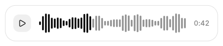

# Waveform

The gallery draws 96 peaks and lets the user click or drag to seek.
Available in **GUI**.



## Example

```pascal
unit Docs.Ui.Motion.Waveform;

uses Fpas.Ui.Elements as E, Fpas.Ui.Widgets.Audio.Waveforms as W;

// Shows a seekable waveform.
// ## Parameters
// - `Peaks`: Normalized peaks in display order.
// - `Progress`: Fraction played from zero through one.
// ## Returns
// The waveform with the proposed progress as its message.
public function View(Peaks: array of float; Progress: float): E.Element<float>;
begin
  return W.Waveform<float>('waveform', Peaks, Progress, function(Next: float): float => Next,
    new W.Options(Height := 34.0F));
end function;

end unit;
```

## Options and defaults

| Option | Default or requirement |
| --- | --- |
| `Peaks / Progress` | Pass normalized samples. Null Progress displays the waveform without a seek cursor. |
| `Width / Height / Bar / Gap` | Fill / 0 / 0 / 0. Zero dimensions use native defaults. |
| `Color / Enabled` | Automatic / true. Color applies to the played bars. |

## Interaction

Supply progress and a callback to enable seeking. Store the proposed
fraction and move playback to the corresponding position.

## See also

- [Widget API and types](../../../../src/Fpas.Ui/Widgets/Audio/Waveforms.fpas)
- [Gallery example](../../../../examples/ui/gui/gallery/Pages/Motion/Controls.fpas)
- [Voice waveform](../voice/voice-waveform.md)
- [Motion](README.md)

## Source files

- `src/Fpas.Ui.Gui/Internal/Widgets/Audio/`
  - [Waveform.fpas](../../../../src/Fpas.Ui.Gui/Internal/Widgets/Audio/Waveform.fpas)
- `src/Fpas.Ui.Gui.Cui/Interop/Audio/`
  - [NativeMethods.Waveform.cs](../../../../src/Fpas.Ui.Gui.Cui/Interop/Audio/NativeMethods.Waveform.cs)
- `src/Fpas.Ui.Gui.Cui/Widgets/Audio/`
  - [CuiWindow.Waveform.cs](../../../../src/Fpas.Ui.Gui.Cui/Widgets/Audio/CuiWindow.Waveform.cs)
- `src/Fpas.Ui.Gui.Cui/native/widgets/audio/`
  - [waveform.c](../../../../src/Fpas.Ui.Gui.Cui/native/widgets/audio/waveform.c)
  - [waveform.h](../../../../src/Fpas.Ui.Gui.Cui/native/widgets/audio/waveform.h)
