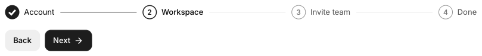

# Stepper

Use a stepper to show progress through an ordered workflow. Available in **GUI**.



## Example

```pascal
unit Docs.Ui.Navigation.Stepper;

uses Fpas.Ui.Elements as E;
uses Fpas.Ui.Widgets.Navigation.Steppers as C;

// Builds the stepper example.
// ## Parameters
// - `Current`: Current value from the application model.
// ## Returns
// The widget for the application view.
public function View(Current: int): E.Element of string;
begin
  return C.Stepper of string('workflow-steps', ['Account', 'Workspace', 'Invite team', 'Done'], Current);
end function;

end unit;
```

## Options and defaults

| Option | Default or requirement |
| --- | --- |
| `Steps` | A nonempty array of literal captions. Use an empty string for an unlabeled step. |
| `Current` | Zero-based step in progress. Pass the step count once all steps are complete. |

## Interaction

The stepper marks preceding steps complete. Each stepper adapts to the width of its own row. A narrow row shows the step markers and the current caption. When every step is complete, a narrow row shows only the markers.

The stepper is read-only and does not receive keyboard focus. The Back and Next buttons in the gallery move between steps. At the last step, Finish shows a completion toast.

## See also

- [CUI widget inventory](../../../cui-widget-inventory.md#cui_stepper)
- [Widget API and types](../../../../src/Fpas.Ui/Widgets/Navigation/Steppers.fpas)
- [Gallery example](../../../../examples/ui/gui/gallery/Pages/Navigation/Widgets/Stepper.fpas)
- [Navigation](README.md)

## Source files

- `src/Fpas.Ui.Gui/Internal/Widgets/Navigation/`
  - [Stepper.fpas](../../../../src/Fpas.Ui.Gui/Internal/Widgets/Navigation/Stepper.fpas)
- `src/Fpas.Ui.Gui.Cui/Interop/Navigation/`
  - [NativeMethods.Stepper.cs](../../../../src/Fpas.Ui.Gui.Cui/Interop/Navigation/NativeMethods.Stepper.cs)
- `src/Fpas.Ui.Gui.Cui/Widgets/Navigation/`
  - [CuiWindow.Stepper.cs](../../../../src/Fpas.Ui.Gui.Cui/Widgets/Navigation/CuiWindow.Stepper.cs)
- `src/Fpas.Ui.Gui.Cui/native/widgets/navigation/`
  - [stepper.c](../../../../src/Fpas.Ui.Gui.Cui/native/widgets/navigation/stepper.c)
  - [stepper.h](../../../../src/Fpas.Ui.Gui.Cui/native/widgets/navigation/stepper.h)
