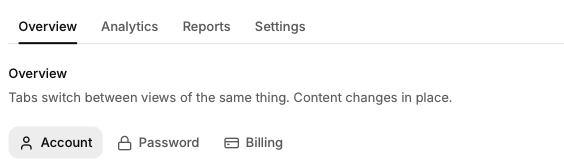

# Tabs

Use tabs to switch the content within one page. The gallery shows an underline strip and a pill strip with icons. Available in **GUI** and [TUI](../../tui/navigation/tabs.md).



## Example

```pascal
unit Docs.Ui.Navigation.Tabs;

uses Fpas.Ui.Elements as E;
uses Fpas.Ui.Widgets.Navigation.Tabs as C;

// Builds the tabs example.
// ## Parameters
// - `Selected`: Current value from the application model.
// ## Returns
// The widget for the application view.
public function View(Selected: int): E.Element of int;
begin
  return C.Tabs of int('tabs', [new C.Item('Overview'), new C.Item('Reports')],
    Selected, function(Index: int): int => Index);
end function;

end unit;
```

## Options and defaults

| Option | Default or requirement |
| --- | --- |
| `Items` | One through 32 tabs in display order. |
| `Item.Label` | Required literal caption and accessible name. |
| `Item.Icon / Item.IconOnly` | Empty / false. An icon-only tab requires a glyph. It keeps its caption in the TUI. |
| `Selected` | Zero-based index from the model. |
| `Appearance` | Underline. Pill is also available. |
| `FullWidth / Enabled` | false / true. |

## Interaction

In the GUI, Tab moves focus to another tab. Click a tab or focus it and press
Enter or Space to select it.
Left and Right move focus and propose the adjacent tab without wrapping.
The selected tab sends no change when activated. Use the proposed index to
select the content in your view.

Set `FullWidth` to distribute the tabs across the available width. Overflowing
underline strips and content-width pill strips scroll horizontally. After the
first layout, changing the selected index brings that tab into view. An initial
selection outside the viewport can stay offscreen. A full-width pill strip
allocates equal widths to the tabs without a scroll viewport.

Use `ItemId(Id, Index)` to focus a specific tab. A focus request for the strip
ID targets its selected tab.

## See also

- [CUI widget inventory](../../../cui-widget-inventory.md#cui_tabs)
- [Widget API and types](../../../../src/Fpas.Ui/Widgets/Navigation/Tabs.fpas)
- [Gallery example](../../../../examples/ui/gui/gallery/Pages/Navigation/Widgets/Tabs.fpas)
- [Sidebar navigation](sidebar.md)
- [Navigation](README.md)

## Source files

- [Shared Navigation gallery examples](../../../../examples/ui/gui/gallery/Shared/TabExamples.fpas)

- `src/Fpas.Ui.Gui/Internal/Widgets/Navigation/`
  - [Tabs.fpas](../../../../src/Fpas.Ui.Gui/Internal/Widgets/Navigation/Tabs.fpas)
- `src/Fpas.Ui.Gui.Cui/Interop/Navigation/`
  - [NativeMethods.Tabs.cs](../../../../src/Fpas.Ui.Gui.Cui/Interop/Navigation/NativeMethods.Tabs.cs)
- `src/Fpas.Ui.Gui.Cui/Widgets/Navigation/`
  - [CuiWindow.Tabs.cs](../../../../src/Fpas.Ui.Gui.Cui/Widgets/Navigation/CuiWindow.Tabs.cs)
- `src/Fpas.Ui.Gui.Cui/native/widgets/navigation/`
  - [tabs.c](../../../../src/Fpas.Ui.Gui.Cui/native/widgets/navigation/tabs.c)
  - [tabs.h](../../../../src/Fpas.Ui.Gui.Cui/native/widgets/navigation/tabs.h)
- `tests/Fpas.Ui.Gui.Cui.Tests/Navigation/`
  - [CuiTabsTests.cs](../../../../tests/Fpas.Ui.Gui.Cui.Tests/Navigation/CuiTabsTests.cs)
