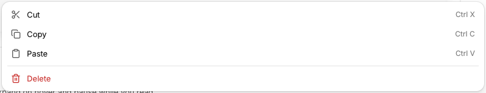

# Context menu

Attach a context menu to the native control that should receive a right click. Available in **GUI**.



## Example

```pascal
unit Docs.Ui.Overlays.ContextMenu;

uses Fpas.Ui.Elements as E,
  Fpas.Ui.Widgets.Overlays.Menus as W;

// Builds the context menu example.
// ## Parameters
// - `Target`: The control that receives the overlay.
// ## Returns
// The widget for the application view.
public function View(Target: E.Element<string>): E.Element<string>;
begin
  return W.ContextMenu<string>('context', Target, [
    W.Entry<string>.Action(new W.Item<string>('copy', 'Copy', 'copy', Shortcut := 'Ctrl C')),
    W.Entry<string>.Separator,
    W.Entry<string>.Action(new W.Item<string>('delete', 'Delete', 'delete', Danger := true))
  ]);
end function;

end unit;
```

## Options and defaults

| Option | Default or requirement |
| --- | --- |
| `Entries` | Keyed commands, section captions and separators. Commands can carry an icon, shortcut hint and checked or danger state. |
| `Enabled` | true. The target retains its own input settings. |

## Interaction

Right-click the target to open the menu at the pointer. Use Up or Down and Enter to choose a command. Escape or an outside click dismisses it. CUI owns the open state. Interactive descendants keep their own hit areas, so attach the menu to the intended control.

## See also

- [Widget API and types](../../../../src/Fpas.Ui/Widgets/Overlays/Menus.fpas)
- [Gallery example](../../../../examples/ui/gui/gallery/Pages/Overlays/Widgets/ContextMenu.fpas)
- [Dropdown menu](../actions/dropdown-menu.md)
- [Overlays](README.md)

## Source files

- [ContextMenu.fpas](../../../../src/Fpas.Ui.Gui/Internal/Widgets/Overlays/ContextMenu.fpas)
- [ContextContract.fpas](../../../../tests/Fixtures/gui-host/ContextContract.fpas)
- [CuiContextMenuTests.cs](../../../../tests/Fpas.Ui.Gui.Cui.Tests/Overlays/CuiContextMenuTests.cs)
