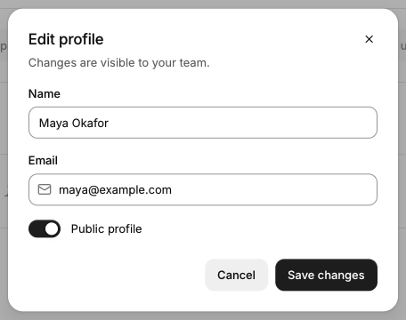

# Dialog

Use a dialog for a focused task that blocks input to the underlying view. Available in **GUI and TUI**.



## Example

```pascal
unit Docs.Ui.Overlays.Dialog;

uses Fpas.Ui.Elements as E,
  Fpas.Ui.Widgets.Overlays.Dialogs as W;

// Builds the dialog example.
// ## Parameters
// - `Base`: The view below the overlay.
// - `Open`: Current visibility from the application model.
// ## Returns
// The widget for the application view.
public function View(Base: E.Element<string>; Open: bool): E.Element<string>;
begin
  return W.Dialog<string>('edit-profile', Base, E.Text<string>('Review the profile details.'), Open,
    new W.Options('Edit profile', Description := 'Changes are visible to your team.'),
    'close-profile');
end function;

end unit;
```

## Options and defaults

| Option | Default or requirement |
| --- | --- |
| `Title / Description` | Title is required. Description defaults to empty. |
| `Width` | 440 logical points. Both hosts fit the width to the viewport. |
| `Persistent / CloseButton` | false / true. Persistent suppresses Escape and scrim dismissal. |
| `InitialFocus` | null. Supply the ID of an enabled control inside the dialog to choose where focus starts. |
| `Draggable / Resizable` | Both default to false. Enable either in a GUI view. |

## Interaction

Click the close button, press Escape or click the scrim to send the dismiss
message. A focused text field gets Escape first. With Persistent enabled,
the close button still sends the message when shown. Closing the dialog restores focus to the preceding control.

In the TUI, put ordinary buttons in a row for actions. The dialog stays
centered when the terminal resizes and its body scrolls if space is limited.
In the GUI, keep the body available during the exit transition.

## See also

- [Widget API and types](../../../../src/Fpas.Ui/Widgets/Overlays/Dialogs.fpas)
- [Terminal gallery](../../../../examples/ui/tui/gallery/README.md)
- [GUI gallery example](../../../../examples/ui/gui/gallery/Pages/Overlays/Widgets/Dialog.fpas)
- [Action footer](action-footer.md)
- [Overlays](README.md)
- [Terminal example](../../tui/overlays/dialog.md)
