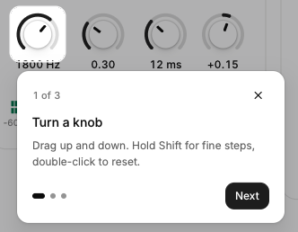

# Guided tour

Use a guided tour to highlight controls and explain them in order. The gallery
walks through the Cutoff knob, master meter and Bass fader. Available in **GUI**.



## Example

```pascal
unit Docs.Ui.Overlays.GuidedTour;

uses Fpas.Ui.Elements as E, Fpas.Ui.Widgets.Overlays.Tours as W;

// Adds a tour to an audio panel.
// ## Parameters
// - `Panel`: Base view containing the cutoff and master controls.
// - `Current`: Zero-based step, or minus one when the tour is closed.
// ## Returns
// The panel with native navigation proposals as application messages.
public function View(Panel: E.Element<W.Change>; Current: int): E.Element<W.Change>;
requires Current >= -1 and Current < 2;
begin
  return W.Tour<W.Change>('audio-tour', Panel,
    [new W.Step(Target := 'cutoff', Title := 'Turn a knob', Body := 'Drag up and down.'),
     new W.Step(Target := 'master', Title := 'Watch the levels')],
    Current, function(Change: W.Change): W.Change => Change);
end function;

end unit;
```

## Options and defaults

| Option | Default or requirement |
| --- | --- |
| `Steps / Current` | Supply at least one step. Use minus one when closed. |
| `Target / Position` | Empty / BottomStart. CUI centers the card if the target is absent and fits the card within the window. |
| `Width / Padding` | 0 / 0. CUI uses 300 logical points for the card and 6 around the target. |
| `BlockTarget` | false. Set true to block pointer input in the spotlight too. |
| `NextLabel / BackLabel / DoneLabel` | Empty uses the native captions. Literal replacements retain the same focus identities. |
| `CountFormat` | Empty uses CUI's default. Up to two `%d` slots (step, total), plus literal `%%`. |

## Interaction

Set the current step to zero to start. CUI draws the spotlight and handles
Back, Next, Done and dismissal. Store `Change.Step` to accept the proposal.
`Change.Action` distinguishes completion from skipping, which both set the
step to minus one.

## See also

- [Widget API and types](../../../../src/Fpas.Ui/Widgets/Overlays/Tours.fpas)
- [Gallery example](../../../../examples/ui/gui/gallery/Pages/Audio/View.fpas)
- [Overlays](README.md)
