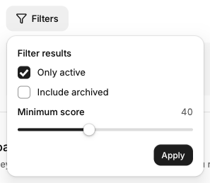

# Popover

Use a popover for a panel anchored to a control. The gallery keeps filter controls inside the panel. Available in **GUI**.



## Example

```pascal
unit Docs.Ui.Overlays.Popover;

uses Fpas.Ui.Elements as E;
uses Fpas.Ui.Widgets.Actions.Buttons as B;
uses Fpas.Ui.Widgets.Overlays.Popovers as W;

// Builds the popover example.
// ## Parameters
// - `Open`: Current visibility from the application model.
// ## Returns
// The widget for the application view.
public function View(Open: bool): E.Element of string;
begin
  return W.Popover of string('filters',
    B.Button of string('filters-trigger', 'Filters', 'toggle-filters'),
    E.Text of string('Filter results'), Open, 'close-filters', new W.Options(Width := 280));
end function;

end unit;
```

## Options and defaults

| Option | Default or requirement |
| --- | --- |
| `Position` | BottomStart. CUI adjusts placement to fit the viewport. |
| `Width / Padding / Gap` | 0 / 0 / 0, which use the native defaults. Positive values are logical points. |

## Interaction

Use the trigger message to open or close the panel in your model. Escape or a press outside sends the dismissal message. Buttons in the body can also close it through their own update. The panel is nonmodal.

## See also

- [CUI widget inventory](../../../cui-widget-inventory.md#cui_popover)
- [Widget API and types](../../../../src/Fpas.Ui/Widgets/Overlays/Popovers.fpas)
- [Gallery example](../../../../examples/ui/gui/gallery/Pages/Overlays/Widgets/Popover.fpas)
- [Confirm popover](../disclosure/confirm-popover.md)
- [Overlays](README.md)

## Source files

- `src/Fpas.Ui.Gui/Internal/Widgets/Overlays/`
  - [Popover.fpas](../../../../src/Fpas.Ui.Gui/Internal/Widgets/Overlays/Popover.fpas)
- `src/Fpas.Ui.Gui.Cui/Interop/Overlays/`
  - [NativeMethods.Popover.cs](../../../../src/Fpas.Ui.Gui.Cui/Interop/Overlays/NativeMethods.Popover.cs)
- `src/Fpas.Ui.Gui.Cui/Widgets/Overlays/`
  - [CuiWindow.Popover.cs](../../../../src/Fpas.Ui.Gui.Cui/Widgets/Overlays/CuiWindow.Popover.cs)
- `src/Fpas.Ui.Gui.Cui/native/widgets/overlays/`
  - [popover.c](../../../../src/Fpas.Ui.Gui.Cui/native/widgets/overlays/popover.c)
  - [popover.h](../../../../src/Fpas.Ui.Gui.Cui/native/widgets/overlays/popover.h)
- `tests/Fixtures/gui-host/`
  - [PopoverContract.fpas](../../../../tests/Fixtures/gui-host/PopoverContract.fpas)
