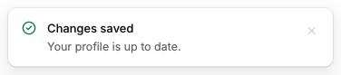

# Toast

Return a toast command from an update after an operation finishes. Available in **GUI**.



## Example

```pascal
unit Docs.Ui.Overlays.Toast;

uses Fpas.Ui.Gui.Toasts as W;
uses Fpas.Ui.Mvu.Application as Mvu;

// Builds the command for the update function.
// ## Returns
// A command that queues one toast in the GUI host.
public function Notify(): Mvu.Command of string;
begin
  return W.Show of string('Changes saved',
    new W.Options(Description := 'Your profile is up to date.', Appearance := W.Tone.Success));
end function;

end unit;
```

## Options and defaults

| Option | Default or requirement |
| --- | --- |
| `Title / Description` | Title is required. Limits are 127 and 191 UTF-8 bytes respectively. |
| `Appearance` | Neutral. Info, Success, Warning and Danger show their own icons. Violet, Teal, Rose and Accent use neutral presentation. |
| `Duration` | 0 uses the default of four seconds, or six with the timer line. A negative duration keeps the toast open. |
| `ActionLabel` | Empty. Set a nonblank caption of up to 47 UTF-8 bytes without the `##` delimiter to add an action that closes the toast. |
| `ShowTimer` | false. Show a draining line while the toast counts down. |
| `OnAction` | Null. Supply a message factory to handle the action in the application. A factory requires an action caption. |

## Interaction

The host shows the toast after committing the model and leaves focus in place. Hover to expand the stack and pause its timer. Use the dismiss button or swipe right to close a toast. The gallery's Archive a message example uses the default duration and closes through its Undo button.

When drawing directly with `CuiWindow`, keep the handle returned by `Toast`.
Use `DismissToast(Handle)` during a frame to close that toast. Repeated
dismissals have no effect. After presenting, `PollToast` reports that the
toast is inactive. Activating the action button produces a separate result.

## See also

- [CUI widget inventory](../../../cui-widget-inventory.md#cui_toast)
- [Widget API and types](../../../../src/Fpas.Ui.Gui/Toasts.fpas)
- [Gallery example](../../../../examples/ui/gui/gallery/Pages/Overlays/Widgets/Toast.fpas)
- [Undo toast](../disclosure/undo-toast.md)
- [Overlays](README.md)

## Source files

- [Toast.fpas](../../../../src/Fpas.Ui.Gui/Internal/Widgets/Feedback/Toast.fpas)
- [ToastContract.fpas](../../../../tests/Fixtures/gui-host/ToastContract.fpas)
