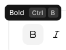

# Tooltip

Attach a tooltip to one control to explain its action or show a shortcut hint. Available in **GUI**.



## Example

```pascal
unit Docs.Ui.Overlays.Tooltip;

uses Fpas.Ui.Elements as E;
uses Fpas.Ui.Widgets.Overlays.Tooltips as W;

// Builds the tooltip example.
// ## Parameters
// - `Target`: The control that receives the overlay.
// ## Returns
// The widget for the application view.
public function View(Target: E.Element of string): E.Element of string;
begin
  return W.Tooltip of string(Target, 'Bold', 'Ctrl B');
end function;

end unit;
```

## Options and defaults

| Option | Default or requirement |
| --- | --- |
| `Text` | A nonblank caption. The caption and shortcut together must fit 255 UTF-8 bytes, including six separator bytes when a shortcut is supplied. |
| `Shortcut` | Empty. Bind the gesture separately. |

## Interaction

CUI opens the tooltip after about 550 ms of hover. Moving directly to another tooltipped control switches the hint immediately while the tooltip is warm. The target keeps its input and layout.

## See also

- [CUI widget inventory](../../../cui-widget-inventory.md#cui_tooltip)
- [Widget API and types](../../../../src/Fpas.Ui/Widgets/Overlays/Tooltips.fpas)
- [Gallery example](../../../../examples/ui/gui/gallery/Pages/Overlays/Widgets/Tooltip.fpas)
- [Overlays](README.md)

## Source files

- `src/Fpas.Ui.Gui/Internal/Widgets/Overlays/`
  - [Tooltip.fpas](../../../../src/Fpas.Ui.Gui/Internal/Widgets/Overlays/Tooltip.fpas)
- `src/Fpas.Ui.Gui.Cui/Interop/Overlays/`
  - [NativeMethods.Tooltip.cs](../../../../src/Fpas.Ui.Gui.Cui/Interop/Overlays/NativeMethods.Tooltip.cs)
- `src/Fpas.Ui.Gui.Cui/Widgets/Overlays/`
  - [CuiWindow.Tooltip.Types.cs](../../../../src/Fpas.Ui.Gui.Cui/Widgets/Overlays/CuiWindow.Tooltip.Types.cs)
  - [CuiWindow.Tooltip.cs](../../../../src/Fpas.Ui.Gui.Cui/Widgets/Overlays/CuiWindow.Tooltip.cs)
- `src/Fpas.Ui.Gui.Cui/native/widgets/overlays/`
  - [tooltip.c](../../../../src/Fpas.Ui.Gui.Cui/native/widgets/overlays/tooltip.c)
  - [tooltip.h](../../../../src/Fpas.Ui.Gui.Cui/native/widgets/overlays/tooltip.h)
- `tests/Fixtures/gui-host/`
  - [TooltipContract.fpas](../../../../tests/Fixtures/gui-host/TooltipContract.fpas)
