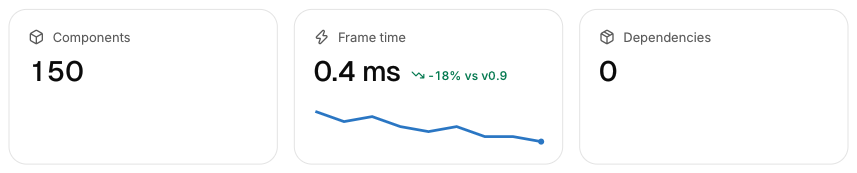

# Metric

Overview shows three metric tiles. Frame time includes a favorable decrease
and a sparkline. Available in **GUI**.



## Example

```pascal
unit Docs.Ui.Overview.Metric;

uses Fpas.Ui.Elements as E, Fpas.Ui.Widgets.Charts.Metrics as W, System as Sys;

// Shows the measured frame time with a gallery trend.
// ## Parameters
// - `Reading`: The formatted value with its unit.
// ## Returns
// A metric tile with a percentage change and sparkline.
public function View(Reading: string): E.Element<string>;
begin
  return W.Metric<string>('frame-time', 'Frame time', Reading,
    new W.Options(
      Delta := -18.0F,
      DeltaLabel := '-18% vs v0.9',
      LowerIsBetter := true,
      Spark := [9.0F, 7.0F, 8.0F, 6.0F, 5.0F, 6.0F, 4.0F, 4.0F, 3.0F],
      Icon := Sys.Char.ConvertFromUtf32($E1B4)
    ));
end function;

end unit;
```

## Options and defaults

| Option | Default or requirement |
| --- | --- |
| `Label / Value` | Supply the caption and the formatted reading, including any unit. |
| `Delta / DeltaLabel` | 0 / empty. Zero with an empty label hides the trend. A label replaces the formatted percentage. |
| `LowerIsBetter` | false. Set true when a decrease is favorable. |
| `Spark` | Empty. Supply at least two finite samples to draw a sparkline. |
| `Icon / Width` | Empty / Fill. |

## Usage

Compute the value and percentage change in the model. Metric displays
them without emitting input events. Use a responsive Grid for several tiles.

## See also

- [Widget API and types](../../../../src/Fpas.Ui/Widgets/Charts/Metrics.fpas)
- [Gallery example](../../../../examples/ui/gui/gallery/Pages/Overview/View.fpas)
- [Grid](../feedback/grid.md)
- [Sparkline](../charts/sparkline.md)
- [Overview](README.md)

## Source files

- `src/Fpas.Ui.Gui/Internal/Widgets/Charts/`
  - [Metric.fpas](../../../../src/Fpas.Ui.Gui/Internal/Widgets/Charts/Metric.fpas)
- `src/Fpas.Ui.Gui.Cui/Interop/Charts/`
  - [NativeMethods.Metric.cs](../../../../src/Fpas.Ui.Gui.Cui/Interop/Charts/NativeMethods.Metric.cs)
- `src/Fpas.Ui.Gui.Cui/Widgets/Charts/`
  - [CuiWindow.Metric.cs](../../../../src/Fpas.Ui.Gui.Cui/Widgets/Charts/CuiWindow.Metric.cs)
- `src/Fpas.Ui.Gui.Cui/native/widgets/charts/`
  - [metric.c](../../../../src/Fpas.Ui.Gui.Cui/native/widgets/charts/metric.c)
  - [metric.h](../../../../src/Fpas.Ui.Gui.Cui/native/widgets/charts/metric.h)
