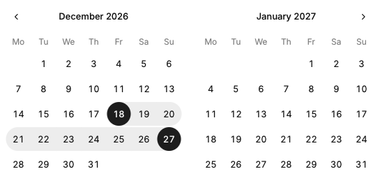

# Date range calendar

Use an inline range calendar when both date choices should stay visible. The gallery shares the range with the Stay dates field. Available in **GUI**.



## Example

```pascal
unit Docs.Ui.Pickers.DateRangeCalendar;

uses Fpas.Ui.Elements as E;
uses Fpas.Ui.Widgets.Pickers.DateRangeCalendars as W;
uses Fpas.Ui.Widgets.Pickers.DateRanges as R;

// Builds the date range calendar example.
// ## Parameters
// - `Stay`: Current value from the application model.
// ## Returns
// The widget for the application view.
public function View(Stay: R.Value): E.Element of R.Value;
begin
  return W.DateRangeCalendar of R.Value('picker-inline-range', Stay, function(Value: R.Value): R.Value => Value);
end function;

end unit;
```

## Options and defaults

| Option | Default or requirement |
| --- | --- |
| `Value` | An empty, started or complete DateRanges.Value. |
| `Months` | 2. Set to 1 for a single month. |
| `Enabled` | true. |

## Interaction

Choose the first and second endpoints in either order. The highlight previews
the interval while you hover a day after the first choice. Tab moves focus and
Enter activates the focused day or month arrow.

The callback receives partial and complete proposals. Store either value in the
model to keep a calendar and a picker in sync. Each calendar keeps its own
displayed month. The navigation arrows move across year boundaries.

## See also

- [CUI widget inventory](../../../cui-widget-inventory.md#cui_range_calendar)
- [Widget API and types](../../../../src/Fpas.Ui/Widgets/Pickers/DateRangeCalendars.fpas)
- [Gallery example](../../../../examples/ui/gui/gallery/Pages/Pickers/Widgets/DateRange.fpas)
- [Date range picker](date-range-picker.md)
- [Pickers](README.md)

## Source files

- `src/Fpas.Ui.Gui/Internal/Widgets/Pickers/`
  - [DateRangeCalendar.fpas](../../../../src/Fpas.Ui.Gui/Internal/Widgets/Pickers/DateRangeCalendar.fpas)
- `src/Fpas.Ui.Gui.Cui/Interop/Pickers/`
  - [NativeMethods.DateRange.cs](../../../../src/Fpas.Ui.Gui.Cui/Interop/Pickers/NativeMethods.DateRange.cs)
- `src/Fpas.Ui.Gui.Cui/Widgets/Pickers/`
  - [CuiWindow.DateRange.Types.cs](../../../../src/Fpas.Ui.Gui.Cui/Widgets/Pickers/CuiWindow.DateRange.Types.cs)
  - [CuiWindow.DateRange.cs](../../../../src/Fpas.Ui.Gui.Cui/Widgets/Pickers/CuiWindow.DateRange.cs)
- `src/Fpas.Ui.Gui.Cui/native/widgets/pickers/`
  - [date_range_calendar.c](../../../../src/Fpas.Ui.Gui.Cui/native/widgets/pickers/date_range_calendar.c)
  - [date_range_calendar.h](../../../../src/Fpas.Ui.Gui.Cui/native/widgets/pickers/date_range_calendar.h)
