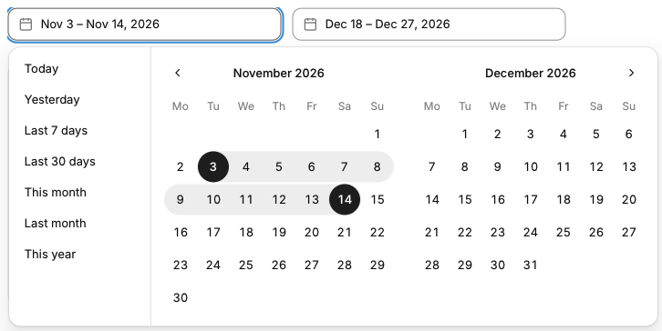

# Date range picker

Use a date range picker for a start date and an end date. The first gallery field shows relative presets, and the second uses a calendar alone. Available in **GUI**.



## Example

```pascal
unit Docs.Ui.Pickers.DateRangePicker;

uses Fpas.Ui.Elements as E;
uses Fpas.Ui.Widgets.Pickers.DateRangePickers as W;
uses Fpas.Ui.Widgets.Pickers.DateRanges as R;

// Builds the date range picker example.
// ## Parameters
// - `Period`: Current value from the application model.
// ## Returns
// The widget for the application view.
public function View(Period: R.Value): E.Element of R.Value;
begin
  return W.DateRangePicker of R.Value('picker-date-range', Period,
    function(Value: R.Value): R.Value => Value, new W.Options(Width := 300.0F));
end function;

end unit;
```

## Options and defaults

| Option | Default or requirement |
| --- | --- |
| `Value` | DateRanges.Value.Empty, Started(Start) or Complete(Start, Finish). Complete endpoints are inclusive and chronological. |
| `Label / Placeholder` | Empty. |
| `Width` | 0 selects CUI's default width. |
| `Presets / Enabled` | true / true. |

## Interaction

Choose the first day to propose `Started` and leave the popup open for the second choice. Choose the other endpoint to propose a complete range. A preset such as Today proposes both endpoints at once. CUI fits the month panels to the available width. Escape dismisses the picker and restores trigger focus.

## See also

- [Widget API and types](../../../../src/Fpas.Ui/Widgets/Pickers/DateRangePickers.fpas)
- [Gallery example](../../../../examples/ui/gui/gallery/Pages/Pickers/Widgets/DateRange.fpas)
- [Date range calendar](date-range-calendar.md)
- [Pickers](README.md)

## Source files

- `src/Fpas.Ui/Widgets/Pickers/`
  - [DateRanges.fpas](../../../../src/Fpas.Ui/Widgets/Pickers/DateRanges.fpas)
- `src/Fpas.Ui.Gui/Internal/Widgets/Pickers/`
  - [DateRangeParts.fpas](../../../../src/Fpas.Ui.Gui/Internal/Widgets/Pickers/DateRangeParts.fpas)
  - [DateRangePicker.fpas](../../../../src/Fpas.Ui.Gui/Internal/Widgets/Pickers/DateRangePicker.fpas)
- `src/Fpas.Ui.Gui.Cui/native/widgets/pickers/`
  - [date_range_picker.c](../../../../src/Fpas.Ui.Gui.Cui/native/widgets/pickers/date_range_picker.c)
  - [date_range_picker.h](../../../../src/Fpas.Ui.Gui.Cui/native/widgets/pickers/date_range_picker.h)
- `tests/Fixtures/gui-host/`
  - [DateRangeContract.fpas](../../../../tests/Fixtures/gui-host/DateRangeContract.fpas)
