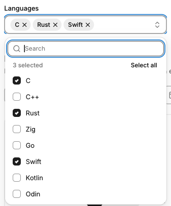

# Multi-select

Use multi-select for independent choices from a fixed list. The field shows the selected items as chips and the popup shows checkboxes. Available in **GUI**.



## Example

```pascal
unit Docs.Ui.Pickers.MultiSelect;

uses Fpas.Ui.Elements as E, Fpas.Ui.Widgets.Inputs.MultiSelects as W,
  Fpas.Ui.Widgets.Inputs.Selects as S;

// Builds the multi-select example.
// ## Parameters
// - `Selected`: Current value from the application model.
// ## Returns
// The widget for the application view.
public function View(Selected: array of bool): E.Element<array of bool>;
begin
  return W.MultiSelect<array of bool>('picker-languages',
    [new S.Item('C'), new S.Item('Rust'), new S.Item('Swift')], Selected,
    function(Value: array of bool): array of bool => Value,
    new W.Options(Label := 'Languages', Searchable := true));
end function;

end unit;
```

## Options and defaults

| Option | Default or requirement |
| --- | --- |
| `Items` | Ordered Selects.Item choices. |
| `Selected` | Supply one Boolean per item in the same order. |
| `Label / Placeholder` | Empty. |
| `Searchable / Enabled` | false / true. |
| `MaxChips` | 0 uses CUI's default limit of three visible chips. Extra selections appear as a count. |

## Interaction

Open the list and toggle checkboxes or use its bulk selection action. Remove a chip to deselect that item. Search filters the visible choices while preserving their original indices. Accept the fresh Boolean array in the model. Escape closes the popup and restores focus to the field.

## See also

- [Widget API and types](../../../../src/Fpas.Ui/Widgets/Inputs/MultiSelects.fpas)
- [Gallery example](../../../../examples/ui/gui/gallery/Pages/Pickers/View.fpas)
- [Select](../inputs/select.md)
- [Pickers](README.md)
