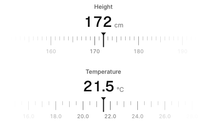

# Ruler slider

Use a ruler slider to move a measurement tape under a fixed marker. The gallery shows height in centimeters and temperature in degrees Celsius. Available in **GUI**.



## Example

```pascal
unit Docs.Ui.Pickers.RulerSlider;

uses Fpas.Ui.Elements as E;
uses Fpas.Ui.Widgets.Charts.Charts as Charts;
uses Fpas.Ui.Widgets.Inputs.RulerSliders as W;

// Builds the ruler slider example.
// ## Parameters
// - `Temperature`: Current value from the application model.
// ## Returns
// The widget for the application view.
public function View(Temperature: float): E.Element of float;
begin
  return W.RulerSlider of float('picker-temperature', 'Temperature', Temperature, 10.0F, 30.0F,
    function(Value: float): float => Value,
    new W.Options(Step := 0.5F, MajorEvery := 4, Spacing := 14.0F,
      Format := new Charts.ValueFormat(DecimalPlaces := 1), UnitLabel := '°C'));
end function;

end unit;
```

## Options and defaults

| Option | Default or requirement |
| --- | --- |
| `Value / Minimum / Maximum` | Finite value within increasing, inclusive bounds. |
| `Step / MajorEvery` | 1 / 10. The step is the value per tick and MajorEvery counts ticks between labels. |
| `Spacing` | 9 logical units between ticks. Use at least one logical unit. |
| `Width` | Fill. Content also fills the available width. Use fixed or percentage widths to size the tape. |
| `Format` | `null` displays zero fractional digits. A [value format](../charts/README.md#value-format) applies to both the measurement and the tick labels. |
| `UnitLabel` | `null` omits the caption. An empty string keeps the caption space. |
| `Enabled` | `true`. |

## Interaction

Drag or scroll over the tape to move between ticks. Use the arrow keys
while the tape has focus. Shift with an arrow moves one major tick
interval. Apply the proposed measurement in the model.

## See also

- [CUI widget inventory](../../../cui-widget-inventory.md#cui_ruler_slider)
- [Widget API and types](../../../../src/Fpas.Ui/Widgets/Inputs/RulerSliders.fpas)
- [Gallery example](../../../../examples/ui/gui/gallery/Pages/Pickers/Widgets/RulerAndHistogram.fpas)
- [Pickers](README.md)

## Source files

- `src/Fpas.Ui.Gui/Internal/Widgets/Inputs/`
  - [RulerSlider.fpas](../../../../src/Fpas.Ui.Gui/Internal/Widgets/Inputs/RulerSlider.fpas)
- `src/Fpas.Ui.Gui.Cui/Interop/Inputs/`
  - [NativeMethods.RulerSlider.cs](../../../../src/Fpas.Ui.Gui.Cui/Interop/Inputs/NativeMethods.RulerSlider.cs)
- `src/Fpas.Ui.Gui.Cui/Widgets/Inputs/`
  - [CuiWindow.RulerSlider.cs](../../../../src/Fpas.Ui.Gui.Cui/Widgets/Inputs/CuiWindow.RulerSlider.cs)
- `src/Fpas.Ui.Gui.Cui/native/widgets/inputs/`
  - [ruler_slider.c](../../../../src/Fpas.Ui.Gui.Cui/native/widgets/inputs/ruler_slider.c)
  - [ruler_slider.h](../../../../src/Fpas.Ui.Gui.Cui/native/widgets/inputs/ruler_slider.h)
- `tests/Fpas.Ui.Gui.Cui.Tests/Inputs/`
  - [CuiRulerSliderTests.cs](../../../../tests/Fpas.Ui.Gui.Cui.Tests/Inputs/CuiRulerSliderTests.cs)
