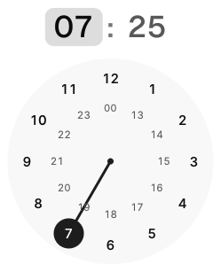

# Time dial

Use an analog dial to select hours and minutes directly on a clock face. Available in **GUI**.



## Example

```pascal
unit Docs.Ui.Pickers.TimeDial;

uses Fpas.Ui.Elements as E;
uses Fpas.Ui.Widgets.Pickers.TimeDials as W;
uses System as Sys;

// Builds the time dial example.
// ## Parameters
// - `Time`: Current value from the application model.
// ## Returns
// The widget for the application view.
public function View(Time: Sys.TimeOnly): E.Element of Sys.TimeOnly;
begin
  return W.TimeDial of Sys.TimeOnly('picker-time-dial', Time, function(Value: Sys.TimeOnly): Sys.TimeOnly => Value,
    Size := 232.0F);
end function;

end unit;
```

## Options and defaults

| Option | Default or requirement |
| --- | --- |
| `Value` | System.TimeOnly at minute precision. |
| `Size` | 0 selects CUI's default face size of 248 logical points. |
| `Enabled` | true. |

## Interaction

Activate the hour or minute selector and choose a point on the dial. Selecting an hour switches the face to minutes. The outer hour ring shows 1–12 and the inner ring shows the remaining 24-hour values. Use `SelectorId` and `FaceId` to identify the native controls.

## See also

- [CUI widget inventory](../../../cui-widget-inventory.md#cui_time_dial)
- [Widget API and types](../../../../src/Fpas.Ui/Widgets/Pickers/TimeDials.fpas)
- [Gallery example](../../../../examples/ui/gui/gallery/Pages/Pickers/Widgets/WheelsAndDial.fpas)
- [Time picker](time-picker.md)
- [Pickers](README.md)

## Source files

- `src/Fpas.Ui.Gui/Internal/Widgets/Pickers/`
  - [TimeDial.fpas](../../../../src/Fpas.Ui.Gui/Internal/Widgets/Pickers/TimeDial.fpas)
- `src/Fpas.Ui.Gui.Cui/Interop/Pickers/`
  - [NativeMethods.TimeDial.cs](../../../../src/Fpas.Ui.Gui.Cui/Interop/Pickers/NativeMethods.TimeDial.cs)
- `src/Fpas.Ui.Gui.Cui/Widgets/Pickers/`
  - [CuiWindow.TimeDial.cs](../../../../src/Fpas.Ui.Gui.Cui/Widgets/Pickers/CuiWindow.TimeDial.cs)
- `src/Fpas.Ui.Gui.Cui/native/widgets/pickers/`
  - [time_dial.c](../../../../src/Fpas.Ui.Gui.Cui/native/widgets/pickers/time_dial.c)
  - [time_dial.h](../../../../src/Fpas.Ui.Gui.Cui/native/widgets/pickers/time_dial.h)
